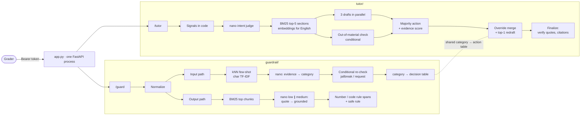

<div align="center">

# 🐈‍⬛ CheshireCat

**An AI tutor with its seatbelt on.**
A knowledge-grounded learning agent and its guardrail, served from one FastAPI app.

[](#-awards)
[](pyproject.toml)
[](app.py)
[](https://github.com/astral-sh/uv)
[](pyproject.toml)

[Awards](#-awards) •
[Overview](#-overview) •
[Key ideas](#-key-ideas) •
[Architecture](#-architecture) •
[What we tried](#-what-we-tried-and-dropped) •
[Quick start](#-quick-start) •
[Docs](#-documentation) •
[Team](#-team)

</div>

---

## 🏆 Awards

> **교육부 장관상 (Minister of Education Award)**
> AI Bootcamp Innovation Challenger 2026 · 엘리스그룹(Elice) 분과
> 주관: 교육부 · 한국산업기술진흥원(KIAT)

## ✨ Overview

CheshireCat is our team's entry to the **"AI Tutor with a Seatbelt"** track of AI Bootcamp Innovation Challenger 2026, run on the Elice platform.
Learners on an online course page ask a tutor about Python, AI prompting and financial literacy.
The tutor must answer **only from the course knowledge base**, cite its sources, and stay on course when pushed.

One server exposes two endpoints:

| Endpoint | What it does |
|---|---|
| `POST /tutor` | Answers from the knowledge base and picks one of 7 actions: `answer`, `scaffold`, `clarify`, `abstain`, `redirect`, `refuse`, `escalate`. Every answer cites section IDs (e.g. `FIN-02-01`). |
| `POST /guard` | Labels the learner's input `allow` / `block` with one of 10 categories (jailbreak, PII, academic dishonesty, emotional distress, …). Given a candidate answer, it also judges whether the answer is **grounded**, returns the **unsupported spans**, and marks it **safe** or not. |

**Constraints that shaped the design**

- 🧠 One small chat model (`gpt-5-nano`) and one embedding model. No GPU, no other APIs, no pretrained model files.
- ⏱️ 30 s per request, 64 concurrent requests, about 600 requests per graded run.
- 🔒 Stateless: every request carries the whole chat and no page context, so the tutor has to work out which lesson the learner is on.
- 🧾 No request bodies in logs, no hard-coded answers, no caching between requests.

## 💡 Key ideas

1. **The LLM labels, code decides.** The model outputs a short piece of evidence and one category. A fixed table ([`config/actions.yaml`](config/actions.yaml)) maps the category to the action and the allow/block decision, so one wobbly judgment cannot produce an inconsistent response.
2. **Short calls for judgment, separate calls for writing.** The tutor splits "what does the learner want?" (intent judge), "can the course answer it?" (out-of-material check) and "write the answer" (main call) into separate small calls, instead of one long prompt doing everything.
3. **Quote, then verify in code.** Every answer sentence carries a quote from the knowledge base. Code checks that the quote really exists in the cited section and drops citations that fail.
4. **Self-consistency where it pays.** The tutor drafts three answers in parallel and keeps the majority action, then prefers the draft best supported by the top-ranked section.
5. **Never fail a request.** Deadlines sit below the 30 s limit (guard 24 s, tutor 27 s). Timeouts, malformed input and LLM errors all return HTTP 200 with a valid fallback.

## 🏗 Architecture



- **One process, two independent judges.** `/guard` and `/tutor` are `APIRouter`s in one uvicorn process. They do not call each other. They share the contract types ([`integration/contracts.py`](integration/contracts.py)), the category → action table and the BM25 engine, so both apply the same standard.
- **`/guard` runs two paths in parallel.**
  - The *input path* builds up to 8 nearest examples, asks `gpt-5-nano` for evidence and a category, and re-checks borderline jailbreak and off-topic calls with a second short prompt.
  - The *output path* retrieves knowledge-base chunks and judges grounding. It asks for the answer quote, then the knowledge-base quote, then the verdict, so the verdict comes last.
  - Unsupported spans come from verified quotes and literal number/code rules. `safe` is rule-based.
- **Fallbacks are layered.** If the input judge fails, a logistic-regression classifier answers. If that fails, a kNN majority vote answers, and the last resort is `normal`.
- **Cheap signals first, but never instead of the model.** Korean normalization and code signals feed the prompts. The only input decided without an LLM is a meaningless one (jamo or symbols only).

Design decisions are recorded as 14 ADRs in [`guardrail/docs/adr/`](guardrail/docs/adr/), including the four we superseded and why.

## 🧪 What we tried and dropped

We kept every change behind a toggle and replaced it only after paired, repeated measurement. Some ideas that did **not** make it:

| Idea | Why we dropped it |
|---|---|
| Reranking retrieval with the LLM | Broke the per-request call budget for no gain |
| Name lexicon / hybrid embeddings for Korean | Top-1 recall did not improve |
| Five drafts instead of three | No better than three, slower |
| Medium reasoning for the main call | Most outputs hit the token limit |
| Feeding the guard's verdict straight into the tutor | Over-blocking went up several times |
| Post-hoc "verify, then abstain" | Removed more correct answers than wrong ones |

The full log of attempts, adopted and not, is in [`docs/2026-11-22-team-attempts.md`](docs/2026-11-22-team-attempts.md) and the result folders below.

## 🚀 Quick start

Needs Python 3.12+ and [uv](https://github.com/astral-sh/uv).

```bash
git clone https://github.com/pataegonia/CheshireCat.git
cd CheshireCat
uv sync --all-packages
```

> **Competition materials are not included.** The official spec, knowledge base, public dev sets and grader belong to the organizers.
> Participants can place them under `competition/` (`kb/`, `public/`, `grader/`) to run the server and the tests.

Set the environment variables (never commit them):

```bash
export TEAM_TOKEN=...            # bearer token the grader sends
export OPENAI_BASE_URL=...  OPENAI_MODEL=gpt-5-nano  OPENAI_API_KEY=...
export EMBEDDING_BASE_URL=... EMBEDDING_MODEL=text-embedding-3-small EMBEDDING_API_KEY=...
```

Run the server and send a request:

```bash
uv run uvicorn app:app --port 8000

curl -s localhost:8000/tutor \
  -H "Authorization: Bearer $TEAM_TOKEN" -H "Content-Type: application/json" \
  -d '{"spec_version":"1.0","session_id":"s_demo","messages":[{"role":"user","content":"What does a for loop do?"}]}'
```

Run the tests (live API tests are skipped by default; most tests need the competition materials):

```bash
uv run pytest tests guardrail/tests
```

## 🛡 Rule safety

Every disqualification rule has a code guard and a test or CI check:

| Rule | How we enforce it |
|---|---|
| No request bodies in logs | 7-field access log only; static check and runtime log grep in CI |
| No external calls or pretrained models | Banned-dependency list and URL-literal check in CI |
| No caching or state | Tests send the same request twice and expect two LLM calls |
| No hard-coding | Test scans server assets for public-set phrases, spacing-insensitive |
| No leaked keys | `gitleaks` over the whole repo on every PR |

## 📁 Repository layout

```
CheshireCat/
├── app.py            # entry point: one app serving /guard and /tutor
├── guardrail/        # /guard: normalization, kNN + LR, BM25, judges, server skeleton, ADRs
├── tutor/            # /tutor: retrieval, intent judge, multi-draft, OOM check, post-processing
├── integration/      # shared contracts, category→action table, finalize (quote/citation checks)
├── harness/          # red-team prompts and memory probes
├── config/           # runtime.yaml, actions.yaml, tutor.yaml
├── tests/            # integration and tutor tests
└── docs/             # team PRD, attempt log, figures
```

## 📚 Documentation

> Most design documents are written in Korean.

| Document | Contents |
|---|---|
| [`docs/PRD.md`](docs/PRD.md) | Team PRD: goals, system structure, shared decisions |
| [`guardrail/docs/PRD.md`](guardrail/docs/PRD.md) · [`adr/`](guardrail/docs/adr/) | Guardrail PRD and 14 design decision records |
| [`tutor/docs/TUTOR_PRD.md`](tutor/docs/TUTOR_PRD.md) | Tutor PRD |
| [`integration/docs/PRD.md`](integration/docs/PRD.md) | Integration & evaluation PRD |
| [`guardrail/results/`](guardrail/results/) · [`tutor/docs/results/`](tutor/docs/results/) | Measurement reports and ablations |
| [`docs/2026-11-22-team-attempts.md`](docs/2026-11-22-team-attempts.md) | Every attempt, adopted or not, in one place |

## 👥 Team

<table>
  <tr>
    <td align="center"><a href="https://github.com/pataegonia"><br/><sub><b>pataegonia</b></sub></a><br/><sub>Tutor</sub></td>
    <td align="center"><a href="https://github.com/danielcho02"><br/><sub><b>danielcho02</b></sub></a><br/><sub>Guardrail</sub></td>
    <td align="center"><a href="https://github.com/pyr27"><br/><sub><b>pyr27</b></sub></a><br/><sub>Integration · Evaluation · CI</sub></td>
    <td align="center"><a href="https://github.com/yang-co1"><br/><sub><b>yang-co1</b></sub></a><br/><sub>Tutor</sub></td>
  </tr>
</table>

## 🙏 Acknowledgements

Thanks to the Ministry of Education (교육부), KIAT (한국산업기술진흥원) and Elice (엘리스그룹) for running AI Bootcamp Innovation Challenger 2026.

<div align="center">
<sub>Course names, banks and stores mentioned in examples are fictional teaching material.</sub>
</div>
