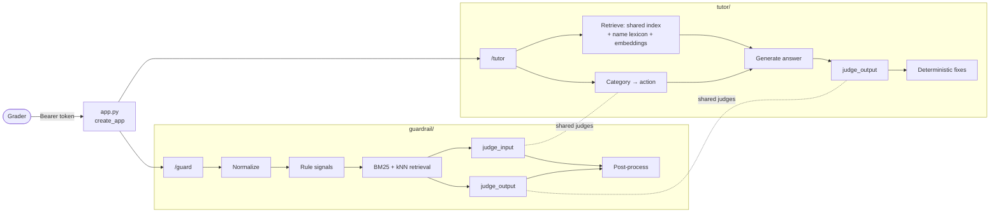

<div align="center">

# 🐈‍⬛ CheshireCat

**An AI tutor with its seatbelt on.**
A knowledge-grounded learning agent and its guardrail, served from one FastAPI app.

[](pyproject.toml)
[](app.py)
[](https://github.com/astral-sh/uv)
[](pyproject.toml)

[Overview](#-overview) •
[Results](#-results) •
[Architecture](#-architecture) •
[Quick start](#-quick-start) •
[Repository layout](#-repository-layout) •
[Docs](#-documentation) •
[Team](#-team)

</div>

---

## ✨ Overview

CheshireCat is our team's entry to the **"AI Tutor with a Seatbelt" challenge** (AI Bootcamp Innovation Challenge 2026, hosted on Elice).
Learners on an online course page ask a tutor about Python, AI prompting and financial literacy.
The tutor has to answer **only from the course knowledge base**, cite its sources, and refuse to be pushed off course.

One server exposes two endpoints:

| Endpoint | What it does |
|---|---|
| `POST /tutor` | Answers from the knowledge base and picks one of 7 actions: `answer`, `scaffold`, `clarify`, `abstain`, `redirect`, `refuse`, `escalate`. Returns citations to section IDs (e.g. `FIN-02-01`). Runs its own guard, because a harmful reply scores 0 whatever its action. |
| `POST /guard` | Labels the input `allow`/`block` with one of 10 categories (jailbreak, PII, academic dishonesty, emotional distress, …). When given a candidate answer, it also judges whether the answer is **grounded**, lists the **unsupported spans**, and marks it **safe** or not. |

**Constraints that shaped the design**

- 🧠 One small chat model only (`gpt-5-nano`) plus `text-embedding-3-small`. No GPU, no other APIs, no pretrained model files.
- ⏱️ 30 s per request, 64 concurrent requests, about 600 requests per graded run.
- 🔒 Stateless: every request carries the full chat history and no page context. The tutor must work out which lesson the learner is on.
- 🧾 No request bodies in logs, no hard-coding, no reuse of grading requests.

## 🏆 Results

Score = 0.5 × tutor + 0.5 × guard. Each side is scored 0 to 100 on a hidden set that changes with every submission.

| Submission | Tutor | Guard | **Total** |
|---|---:|---:|---:|
| Best (`167f7c9`, 2026-11-20) | 90.22 | 94.25 | **92.23** |

Hidden-set samples differ per submission, so scores vary by a few points between runs of the same commit.

## 🏗 Architecture



- **One process, one index.** FastAPI and uvicorn in a single process. The guard and the tutor are `APIRouter`s that share the guard's `KbIndex` and its judge functions, so both apply one safety standard.
- **Cheap signals first.** Korean text normalization and deterministic rules (crisis language is handled before any LLM call) narrow the case before the model sees it.
- **Two parallel LLM calls** on `/guard` (input judge ∥ output judge). The answer judge checks grounding sentence by sentence and verifies that each quoted span really appears in the answer.
- **The app never fails a request.** Auth, deadlines, per-route fallback replies and an LLM concurrency gate live in `guardrail.server:create_app`. Every request gets HTTP 200 with valid JSON.

Design decisions are recorded as ADRs in [`guardrail/docs/adr/`](guardrail/docs/adr/).

## 🚀 Quick start

Needs Python 3.12+ and [uv](https://github.com/astral-sh/uv).

```bash
git clone https://github.com/pataegonia/CheshireCat.git
cd CheshireCat
uv sync --all-packages
```

Set the environment variables (never commit them):

```bash
export TEAM_TOKEN=...            # bearer token the grader sends
export OPENAI_BASE_URL=...  OPENAI_MODEL=gpt-5-nano  OPENAI_API_KEY=...
export EMBEDDING_BASE_URL=... EMBEDDING_MODEL=text-embedding-3-small EMBEDDING_API_KEY=...
```

Run the server and send a request:

```bash
uv run uvicorn app:app --port 8000

curl -s localhost:8000/tutor \
  -H "Authorization: Bearer $TEAM_TOKEN" -H "Content-Type: application/json" \
  -d '{"spec_version":"1.0","session_id":"s_demo","messages":[{"role":"user","content":"What does a for loop do?"}]}'
```

Run the tests (live API tests are skipped by default):

```bash
uv run pytest tests guardrail/tests
```

## 📁 Repository layout

```
CheshireCat/
├── app.py            # entry point: one app serving /guard and /tutor
├── guardrail/        # /guard: normalization, rules, KbIndex (BM25), judges, server skeleton
├── tutor/            # /tutor: retrieval, action routing, answer generation, post-processing
├── integration/      # shared contracts, category→action table, deterministic fixes
├── harness/          # red-team prompts and memory probes
├── config/           # runtime.yaml, actions.yaml, tutor.yaml
├── competition/      # official spec, knowledge base (PY · PR · FIN), public dev sets, local grader
├── tests/            # integration and tutor tests
└── docs/             # team PRD and presentation slides
```

## 📚 Documentation

> Most design documents are written in Korean.

| Document | Contents |
|---|---|
| [`competition/SPEC.md`](competition/SPEC.md) | Official participant spec: API contract, scoring, rules |
| [`docs/PRD.md`](docs/PRD.md) | Team PRD: goals, system structure, shared decisions |
| [`guardrail/docs/PRD.md`](guardrail/docs/PRD.md) | Guardrail PRD |
| [`guardrail/docs/adr/`](guardrail/docs/adr/) | Architecture decision records |
| [`tutor/docs/TUTOR_PRD.md`](tutor/docs/TUTOR_PRD.md) | Tutor PRD |
| [`integration/docs/PRD.md`](integration/docs/PRD.md) | Integration & evaluation PRD |

## 👥 Team

<table>
  <tr>
    <td align="center"><a href="https://github.com/pataegonia"><br/><sub><b>pataegonia</b></sub></a></td>
    <td align="center"><a href="https://github.com/danielcho02"><br/><sub><b>danielcho02</b></sub></a></td>
    <td align="center"><a href="https://github.com/pyr27"><br/><sub><b>pyr27</b></sub></a></td>
    <td align="center"><a href="https://github.com/yang-co1"><br/><sub><b>yang-co1</b></sub></a></td>
  </tr>
</table>

<div align="center">
<sub>Built for the AI Bootcamp Innovation Challenge 2026. Course names, banks and stores in the knowledge base are fictional teaching material.</sub>
</div>
