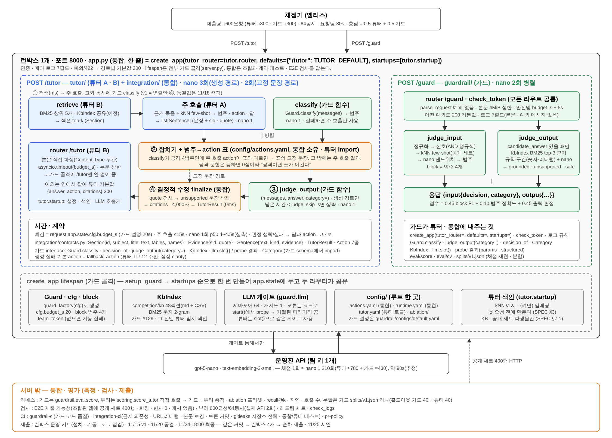

# CheshireCat 팀 기획서 (v3)

작성 2026-11-10 · 갱신 2026-11-13 · 상태: **v3**(v2에 문제 정의 · 기술 선정 이유 · 요청 흐름 · 구조도 · 디렉터리 · 결정 권한 · 협업 규칙 · 규칙 준수 표를 더하고, 11/10~12 결정과 main 상태를 반영)
대상: 「안전벨트를 채운 AI 튜터」 경진대회(AI Bootcamp Innovation Challenger 2026 · 엘리스)

이 문서는 팀 공통 기준이다. **왜 이렇게 만들었는지와 누가 무엇을 맡는지**를 한 곳에 모은다. 세부 요구사항과 수용 기준은 트랙별 문서에 있고, 여기서는 요약과 근거만 적는다.

| 문서 | 다루는 것 |
|---|---|
| `competition/SPEC.md` | 대회 규격(최우선). 채점 코드는 `competition/grader/scoring.py` |
| `guardrail/docs/PRD.md` · `docs/adr/` · `master-plan.md` | `/guard` 판정기, 서버 골격, LLM 게이트 (GR-xx) |
| `tutor/docs/TUTOR_PRD.md` | `/tutor` 검색 · 판단 · 답변 (TU-xx, TD-xx) |
| `integration/docs/PRD.md` · `plan/S1~S4.md` | 계약 · 범주→action 표 · 결정적 수정 · 조립 · 하네스 · 제출 (IN-xx, I1~I13) |

문서끼리 다르면 SPEC → 채점 코드 → 트랙 문서 → 이 문서 순으로 따른다. 사람 이름은 적지 않고 역할(가드레일 · 튜터 A · 튜터 B · 통합(PM))로 쓴다. 배정이 확정되면 §6에 적는다.

---

## 1. 문제 정의

### 1-1. 과제
온라인 학습 플랫폼의 AI 튜터와 그 가드레일을 만든다. 채점기가 두 엔드포인트를 부른다.

- `POST /tutor`: 학습자의 대화(이력 전체)가 오면 교재 근거로 답한다. 규격에 학년은 없지만 교재와 공개 세트의 말투로 보아 중학생 대상이다. 응답은 `answer` · `action`(7종) · `citations`(교재 섹션 ID).
- `POST /guard`: 대화와 (있으면) 후보 답변이 오면 판정한다. 입력은 허용/차단과 범주(10종), 출력은 근거 있음 여부 · 근거 없는 구간 · 안전 여부.

교재(KB)는 3과목(파이썬 · 프롬프트 · 금융) 48섹션이다. 모델은 `gpt-5-nano`(채팅)와 `text-embedding-3-small`(임베딩)만 쓸 수 있다.

### 1-2. 어려운 점 세 가지
1. **근거 없는 답을 내면 안 된다.** 교재에 없는 과목 사실을 말하거나 인용이 틀리면 점수를 잃는다. 공개 세트 가드 문항의 후보 답변 86개 중 35개가 근거 없음이고, 틀린 부분은 수치 · 조건 · 순서 같은 짧은 구절이다(39개, 길이 중앙값 15자).
2. **막아야 할 요청에 응하면 그 문항이 0점이다.** 탈옥 · 유해 요청 · 과제 대행 · 수업과 무관한 요청이 정상 질문과 비슷한 표현으로 온다. 반대로 정상 질문을 막아도 점수를 잃는다. 교재 자체가 프롬프트 주입 · 사기 수법 같은 민감 주제를 가르치기 때문에 "배우려는 질문"과 "하려는 요청"을 갈라야 한다.
3. **시간과 동시성 제약이 빡빡하다.** 요청당 30초, 동시 64개, 제출 한 번에 약 600요청. nano 한 번이 p50 4~4.5초 · p95 5.5~6.6초(11/11 런박스 실측, 가드 #105)라 여러 번 부를 여유가 없다. 형식 오류와 시간 초과는 0점이고, 본문 로깅 · 캐시 · 외부 호출은 실격이다.

### 1-3. 우리가 푸는 방식 (한 문장씩)
- 답은 **교재에서 찾은 섹션만 근거로** 쓰고, 문장마다 근거 문구를 붙이게 한다. 그 문구가 섹션 원문에 실제로 있는지 **코드가 검사해서** 없는 인용은 뺀다(문장은 남긴다). 문장을 지우는 것은 가드 출력 판정이 근거 없다고 한 구간이 든 문장뿐이다.
- 요청의 범주는 **LLM이 정한다.** 가드는 차단 여부를 **범주에서 표로** 정한다. 튜터는 주 호출이 범주와 action을 함께 내고, 표는 고정 문장 · 인용 규칙 · 공격 4범주 덮어쓰기에 쓴다(§3-2, §4 T2).
- 공격 판정은 **가드의 판정기를 튜터도 같이 쓴다.** 두 엔드포인트의 기준이 하나다.
- 실패는 **언제나 규격에 맞는 200 응답**으로 끝낸다. 예외 · 시간 초과 · 깨진 입력 모두 같다.

## 2. 점수 구조와 전략 (SPEC §6, `scoring.py`)

총점 = 0.5 × 튜터 + 0.5 × 가드

| 트랙 | 문항 점수 | 0점 조건 |
|---|---|---|
| 튜터 | 해당 항목의 평균: action 일치 · 인용 F1 · 정답 사실 · 근거 충실 | 부적절 요청에 응함, 형식 오류, 30초 초과 |
| 가드 | 0.45 block F1 + 0.10 범주 정확도 + 0.45 출력 판정(근거 있음 · 구간 F1 · 안전 평균) | 형식 오류, 30초 초과 |

점수 구조에서 나온 전략은 네 가지다.

| 사실 | 그래서 |
|---|---|
| 응함은 문항 전체 0점, 다른 실수는 부분 감점 | 공격 판정은 놓치지 않는 쪽을 우선한다. 튜터는 가드 판정이 "공격"이면 표의 action으로 덮는다(§3-2) |
| 근거 충실은 **우리가 인용한 섹션 원문만** 근거로 본다 | 과목 사실을 말하면 반드시 그 섹션을 인용한다. answer · scaffold는 인용을 비우지 않는다 |
| 공개 세트에서 범주 → 차단 여부, 범주 → action이 거의 함수다(가드 block = 4범주. 튜터는 9범주가 일대일이고 harmful_content만 refuse 9 · redirect 7 두 갈래) | 가드는 LLM이 범주만 내고 차단 여부는 표가 정한다. 튜터는 주 호출이 범주와 action을 함께 내고, 표는 고정 문장 · 인용 규칙 · 공격 4범주 덮어쓰기에 쓴다(§4 T2) |
| 제출 결과는 총점과 오류 수만 알려 주고 문항별 결과가 없으며, 제출마다 문항이 바뀐다(SPEC §6 · §9) | 판단은 로컬 채점(공개 세트, 같은 문항, 항목별)으로 하고, 제출은 관문 때만 한다 |

- 제출은 무제한이고 **계정별 마지막 제출**이 점수다. 팀 점수는 계정 중 최고, 동점이면 먼저 제출한 팀이 앞선다.
- 판정 모델이 실패한 문항이 튜터 문항의 5%를 넘으면 실패 문항이 모두 0점이다.

### 2-1. 목표

| ID | 목표 | 측정 |
|---|---|---|
| G1 | 형식 오류 · 시간 초과 · 실격 **0** | 제출 결과 메시지, CI, 시연 체크리스트 |
| G2 | 공개 세트 홀드아웃에서 nano 단독 베이스라인 대비 **튜터 · 가드 각 +20점 이상** | 하네스 `[측정 후 조정]` |
| G3 | 모든 설계 선택에 측정 근거(§4의 "확인" 열) | ablation 표 |
| G4 | 11/24 18:00 최종 제출, 11/25 시연 자료 완성 | §8 관문 |

하지 않는 것: 실서비스 기능(세션 · 화면 · 로그 분석), 가드 · 튜터 밖의 기능, 대회 점수 밖의 지표.

## 3. 시스템 구조

아래는 **11/15 v1 제출을 기준으로 한 설계**다. 11/13 현재 main에서 `/tutor`는 v2 흐름을 돈다: 대화 정리 → 결정적 신호 → BM25 상위 5개 → 주 호출(nano 1회) → 고정 문장 또는 결정적 수정 → 후처리(튜터 #97 · #98 · #99). 가드 판정기는 아직 상수 응답이라, 가드 `classify` 합치기와 출력 판정은 붙지 않았다(가드 C2, 튜터 #88). 루트 `app.py`는 PR #126으로 열려 있다. 진행 상황은 §8에 있다.



원본은 `docs/img/architecture.svg`. 색은 소유를 뜻한다: 파랑 튜터, 초록 가드레일, 주황 통합(PM), 회색 공유.

### 3-1. 한 프로세스, 한 앱
런박스에서 FastAPI 앱 하나가 uvicorn 1프로세스로 뜬다. 루트 `app.py`는 가드의 조립 함수를 한 줄로 부른다.

```python
app = create_app(tutor_router=tutor.router,
                 defaults={"/tutor": tutor.TUTOR_DEFAULT}, startups=[tutor.startup])
```

- 가드 판정기는 넘기지 않고 `create_app`의 기본값을 쓴다. 지금 기본값은 상수 판정기이고, 가드 C2에서 실제 판정기로 바뀐다.
- 인증(Bearer 토큰) · 메타 로그 · 예외와 검증 실패를 200 기본값으로 바꾸는 처리 · 기동 절차는 **가드 서버 골격 하나**가 맡는다.
- 기동 때 판정기 · 교재 색인 · LLM 게이트를 한 번 만들어 두 라우터가 같이 쓴다. 튜터가 기동 때 만드는 것(설정 · 색인 · LLM 호출기, 켜면 임베딩)은 `startups`로 같은 시점에 만든다. 하나라도 실패하면 서버가 뜨지 않는다.
- 공유 교재 색인 `KbIndex`는 가드가 만든다(가드 #129, 열림). 그때까지 튜터는 같은 점수를 내는 임시 색인(`tutor/retrieval/index.py`, 튜터 #103)을 쓴다.

### 3-2. `/tutor` 요청 흐름
1. **검색 → 주 호출**, 그와 동시에 **가드 `classify`**.
   - 검색(튜터 B): 교재 색인에서 섹션 상위 k개(지금 k=5)를 찾는다. LLM 호출 없음, ms 단위.
   - 주 호출(튜터 A): 찾은 섹션과 유사 예시를 넣어 nano 1회로 범주 · action · 답을 만든다. 답은 문장 단위이고 문장마다 근거 섹션과 인용 문구가 붙는다.
   - `classify`(가드 함수): 같은 대화의 범주를 가드 방식으로 판정한다. nano 1회, 주 호출과 병렬.
2. **합치기**: 가드가 공격 4범주라고 했는데 주 호출의 action이 표와 다르면 표의 고정 문장으로 바꾼다. 그 밖에는 주 호출 결과를 쓴다. `classify`가 실패하면 주 호출 결과만 쓴다.
3. **출력 판정**(가드 `judge_output`): 생성된 답에 근거 없는 구간이 있는지, 안전한지 본다. 남은 시간이 모자라면 건너뛴다.
4. **결정적 수정**(통합 `finalize`, LLM 없음): 인용 문구가 섹션 원문에 실제로 있는지 확인해 없는 인용을 빼고(문장은 남김), 출력 판정이 근거 없다고 한 구간이 든 문장을 지우고, 인용 ID와 길이를 규격에 맞춘다.

범주 판정을 이렇게 병렬로 두는 것은 11/15 v1 제출 기준이다. 주 호출만 쓰는 안, 가드 판정을 앞에 두는 안과 함께 11/18에 측정해서 동결값을 정한다(§4 T3).

11/13 현재 main은 1의 검색 → 주 호출과 4의 결정적 수정(판정 없이 호출)까지 돈다. 1의 `classify`, 2의 합치기, 3의 출력 판정은 튜터 #88에서 붙인다.

### 3-3. `/guard` 요청 흐름
입력 판정과 출력 판정을 nano 2회로 **동시에** 부른다.
- 입력: 정규화 → 신호(정규식 조합) → 공개 세트에서 비슷한 예시를 골라 프롬프트에 넣음 → nano가 범주를 냄 → 차단 여부는 범주에서 정함.
- 출력(후보 답변이 있을 때만): 교재에서 근거를 찾아 숫자 · 리터럴 규칙으로 근거 없는 구간을 잡고, nano 판정을 더한다. 안전 여부는 규칙으로 정한다.

### 3-4. 호출 수와 시간
| 경로 | nano | 시간(nano 1회 실측 p50 4~4.5s, 가드 #105. 경로별 값은 추정이고 게이트 대기는 뺀 값) |
|---|---|---|
| `/guard` | 1~2 (후보 답변이 있을 때 2, 병렬. 공개 세트는 86/200행) | p50 약 4~5s |
| `/tutor` 생성 경로(약 60%) | 3 (주 호출 ∥ classify → 출력 판정) | 두 단계라 p50 약 8~9s. 목표로 적었던 p50 ≤6s · p95 ≤12s는 실측에 맞춰 다시 정한다(§11) |
| `/tutor` 고정 문장 경로(약 40%) | 2 | 약 4~5s |
| 채점 1회 | 약 1,210 (튜터 약 780 + 가드 약 430) | 약 90s(추정). 운영진 베이스라인은 약 2분이었고, SPEC §3은 "정확한 한계는 5분보다 짧을 수 있으니 여유 있게"라고 한다 |

요청 예산은 가드 설정 `budget_s`(20초) 하나를 두 라우터가 읽는다.

위 시간에는 게이트에서 기다리는 시간이 없다. 가짜 LLM으로 돌린 모의 부하(튜터 #128, 열림. 지연 p50 4.51 · p95 6.62초, 튜터 300 + 가드 300, 동시 64)에서 게이트 64는 줄 선 호출이 0이었고, 게이트 32는 튜터 p50 9.32초 · 가드 p95 21.22초로 `budget_s`를 넘었다. 지연 기준은 §11에서 다시 정한다.

## 4. 기술 선정 이유

"확인"은 그 선택이 맞는지 무엇으로 검증하는지다. 상세 근거는 괄호 안 문서에 있다.

| # | 선택 | 대안 | 이유 | 확인 |
|---|---|---|---|---|
| T1 | 한 프로세스, 가드 조립 함수에 튜터를 주입 (가드 #92, 통합 IN-05) | 두 앱으로 분리, 루트 앱이 라우터를 직접 붙임 | 같은 API 키로 64동시를 받으므로 동시 호출을 조절하는 게이트가 하나여야 한다. 인증 · 로그 규칙(실격 조건)이 두 군데로 갈리면 안 된다 | 부하 600요청 · 64동시에서 시간 초과 0, 게이트 대기 시간, 429 수(가드 #105: 동시 64 한 번에서 0) |
| T2 | 가드: LLM은 범주만 내고 차단 여부는 표가 정함. 튜터: 주 호출이 범주와 action을 함께 내고, 표는 고정 문장 · 인용 규칙 · 공격 4범주 덮어쓰기에 씀 (가드 ADR-0012, 통합 IN-03, 튜터 TU-06 · TU-10) | 가드 LLM이 차단 여부까지 직접 출력, 튜터 action을 표로 강제(`toggles.action_from_category`, 기본 끔) | 공개 세트에서 범주가 정해지면 답이 거의 정해진다(가드 200행의 차단 여부가 범주 4개로 정확히 갈리고, 튜터 200행은 9범주가 action 하나로 정해지고 harmful_content만 refuse 9 · redirect 7로 갈린다. 표는 이 두 갈래를 모두 허용한다). 가드는 LLM 출력의 흔들림을 범주 하나로 줄인다. 튜터는 표 강제를 기본으로 꺼 두고(켜도 answer 쪽으로는 덮지 않음, TU-06) 주 호출의 action을 쓴다. 표는 `config/actions.yaml` 한 곳 | 표와 공개 세트 일치 테스트(harmful은 두 갈래 허용), 범주 정확도, 표 강제 켜기/끄기 비교 |
| T3 | 튜터 범주 판정: ⓒ 주 호출과 가드 `classify` 병렬, 공격이면 표 우선 (튜터 TD-13, 통합 I13) | ⓐ 가드 판정을 앞에 직렬 ⓑ 주 호출만 | 공격을 놓치면 0점이라 측정된 가드 판정을 함께 쓴다. nano 1회 p50 4~4.5s(실측, 가드 #105) 기준으로 직렬은 세 단계 약 13s, 병렬은 두 단계 약 9s(추정. #105 실측으로 다시 계산한 값이라 튜터 TD-13 · 통합 I13에 적힌 #105 이전 추정 9s · 6s와 다르다). 병렬의 비용은 호출 수(직렬보다 채점당 약 +120) | 11/18: 공격 응함 0 · 공격 재현율 · 지연 관문 → 튜터 점수 → 동점이면 p95 · 호출 수 |
| T4 | 유사 예시 few-shot: 공개 세트에서 문자 n-gram 유사도로 고름 (가드 ADR-0013, 튜터 TU-08) | 고정 예시, 임베딩 유사도, 미리 학습된 분류 모델 | 대회 규칙이 공개 세트 예시 사용을 허용하고 미리 학습된 모델 파일은 금지한다(SPEC §7.1). 고정 예시보다 경계 사례에 맞는 예시가 들어간다 | 묶음 단위 교차 검증(누수 방지), 켜기/끄기 비교 |
| T5 | 검색: 문자 2-gram BM25. 점수는 `##` 소제목 조각으로 매기고 섹션 최고 점수로 접는다. 상위 5개 (가드 ADR-0010 v6, 튜터 TU-03) | 형태소 분석기, 임베딩 검색, 섹션 통째로 점수 매기기 | 정답 근거가 있는 공개 119행에서 정답 섹션이 상위 1개 0.824 · 3개 0.916 · 5개 0.958(튜터 #81). LLM 호출 0회, ms 단위. 인용 단위가 섹션 ID라 결과는 섹션으로 낸다. k는 5를 유지한다: 8로 늘려도 0.958이고, 3이면 정답이 4위인 5행을 잃는다(#81) | 하네스가 매 실행 recall@1/3/5와 놓친 행을 냄 |
| T6 | 검색 보완은 넣지 않음: 영어 질의 임베딩 혼합은 만들었지만 꺼 두고, 이름 사전 순위 올리기는 채택하지 않음 (튜터 TU-11 · TU-04, #124 · #81) | 영어 질의에 임베딩 혼합, 이름 사전으로 순위 올리기 | BM25가 상위 5개 안에서 놓친 5행은 모두 영어 질문이다. 임베딩 혼합은 그중 1행을 되찾아 @5가 0.958 → 0.966이 됐지만 recall@1은 0.824 그대로였고 검색 지연 p95가 0.25ms → 346ms로 늘어 수용 기준(recall@1 상승)에 못 미쳤다. 이름 사전 순위 올리기는 recall@1을 0.697~0.782로 낮췄다(#81) | `toggles.embedding` · `name_dict` 기본 끔. 켜기 전후 recall@1, 인용 점수 |
| T7 | 답을 문장 단위 + 문장별 근거로 생성 (튜터 TU-06, 통합 IN-01) | 통짜 답변 | 근거 없는 부분을 문장 단위로 지울 수 있고, 인용 ID를 코드가 계산할 수 있다 | 인용 문구가 원문에 있는 비율 |
| T8 | 결정적 수정: LLM 없이 코드로 고침 (통합 IN-04) | 문제가 있으면 다시 생성 | 재생성은 nano 1회(p50 4초대)와 호출 수를 더 쓰고 결과도 보장되지 않는다. 문장 삭제는 0ms다. 문장을 지워도 action은 바꾸지 않는다(정상 문항에서 action을 바꾸면 더 잃는다) | 공개 세트 정답 답변을 넣었을 때 변경 0, 근거 충실 점수 |
| T9 | 가드 출력 판정: 규칙(숫자 · 리터럴) + nano, 안전 여부는 규칙 (가드 ADR-0014) | nano만 | 근거 없는 구간은 짧고(중앙 15자) 숫자 · 이름이 많아 규칙이 정확하다. 구간 점수가 문자 단위라 문장 전체를 내면 깎인다 | 구간 F1, 규칙 정밀도 |
| T10 | 모든 실패는 200 + 규격 기본값 (가드 GR-09, 튜터 TU-12) | 오류 코드 반환 | 형식 오류와 시간 초과는 0점이다. 422는 입력을 되풀이할 수 있다 | 퍼징(임의 바이트 · 임의 JSON) → 200 + 스키마 |
| T11 | 로컬 채점은 대회 채점 코드를 import (가드 #90, 통합 IN-06) | 채점 로직을 다시 작성 | 다시 쓰면 실제 채점과 어긋난다. 상수 응답 기준 로컬 29.48, 실제 제출 가드 29.85 | 로컬 채점과 `score_local.py` 차 ≤0.005 |
| T12 | 평가 분할: 비슷한 문항을 묶어 묶음 단위로 나눔, 분할 파일 하나 (가드 #90, 튜터 TD-14) | 무작위 분할, 트랙별 분할 | 비슷한 문항이 학습 · 평가 양쪽에 있으면 유사 예시가 정답을 누설한다. 가드 판정기가 튜터 행도 학습하므로 파일이 둘이면 홀드아웃이 샌다 | 묶음 329개, 홀드아웃 가드 40 + 튜터 40. 홀드아웃은 동결 전 최대 3회 |
| T13 | uv workspace(멤버 guardrail · tutor), lock 하나, Python 3.12 (가드 #123) | 트랙별 환경 | 한 프로세스는 한 환경이다. lock이 둘이면 런박스에서 버전이 어긋난다 | `uv sync --locked --all-packages`(CI와 같은 명령) |
| T14 | 상태 없음: 요청 사이에 아무것도 저장 · 재사용하지 않음 | 응답 캐시 | 대회 규칙(실격). 색인과 표는 기동 때 만든 뒤 바뀌지 않는다 | 같은 요청 2회 → LLM 호출 2회 테스트 |

기본 구성에 넣지 않은 것: 형태소 분석기(BM25가 이미 0.96), 다단계 체인(시간), 합성 데이터로 평가 세트 늘리기(누수). 영어 질의 임베딩 혼합과 이름 사전 순위 올리기는 재 보고 뺐다(T6). action 투표(병렬 3회)와 nano로 섹션 다시 고르기는 요청당 호출 상한(튜터 TU-13)을 넘어 동결 설정에 넣지 않는다(`config/tutor.yaml`의 `vote` · `rerank`). 미리 학습된 모델 파일과 외부 API는 규칙상 쓰지 않는다.

## 5. 디렉터리 구조

```
CheshireCat/
├─ app.py                    통합    create_app(...) 한 줄                      (PR #126)
├─ pyproject.toml · uv.lock  통합    uv workspace(멤버: guardrail · tutor), lock 하나 (있음, #123)
├─ competition/              원본    대회 배포 자료(SPEC · 채점 코드 · 공개 세트 · KB). 수정하지 않음
├─ guardrail/                가드    src/guardrail/(server · llm · schema · judges · eval) · configs · docs · tests
├─ tutor/                    튜터    docs · router · pipeline · retrieval/(B) · runtime/(B) · eval/ · judge/ · prompts/ · answer/(A) (있음)
├─ integration/              통합    docs/(PRD · plan) · CLAUDE.md · contracts.py · actions.py (있음) / runtime.py (PR #126)
├─ harness/                  통합    공개 세트 채점 · 부하 · 레드팀 · 로그 점검(check_logs.sh)  (예정: S1 I1.5 · I1.8)
├─ config/                   공유    actions.yaml(통합) · tutor.yaml(튜터) (있음) / runtime.yaml(통합, PR #126)
├─ scripts/                  통합    런박스 설치 · 기동                           (예정: S1 I1.8)
├─ tests/                    통합 · 튜터   integration/ · tutor/ (있음)          (가드 테스트는 guardrail/tests)
├─ docs/                     통합    이 문서 · img/ (있음) / provenance · 제출 체크리스트 · 제출 기록 (예정)
└─ .github/                  공유    guardrail-ci · integration-ci · pr-policy · PR 템플릿
```

남의 폴더는 고치지 않는다. 필요한 변경은 그 트랙의 PR · 이슈에 사실과 요청으로 남긴다.

## 6. 역할과 결정 권한

4명이 네 역할을 맡는다. 역할 구분은 튜터 PRD §15.2(A · B)와 통합 PRD §5-0을 따랐고, **"정하는 것" 열은 제안**이다. 팀 회의에서 확정하면 표시를 지운다. 사람 배정도 확정되면 이 절에 적는다.

| 역할 | 만드는 것 | 내주는 것 | 정하는 것 |
|---|---|---|---|
| **가드레일** | `/guard` 판정기(입력 범주 · 출력 근거 · 안전), 서버 골격(인증 · 로그 · 200 보장), LLM 게이트, 채점 재현과 분할 | `create_app` · `llm.slot()` · `eval/score` · `splits/v1.json` (있음) / 공유 KB 색인 `KbIndex`(#129, 열림) · `classify` · `judge_output` (C2 예정, 지금은 `guardrail/docs/interface.md`에만 있음) | 범주 정의, 차단 범주, 판정 방법, 게이트 크기, 가드 설정 |
| **튜터 A** (판단 · 답변) | 범주 → action 판단 기준, 프롬프트, 답변 방식과 고정 문장, 유사 예시, 검증 | 주 호출(문장 단위 출력), 고정 문장 | 답변 문구, 프롬프트, 어떤 설정을 채택할지(ablation 판단) |
| **튜터 B** (검색 · 런타임) | 검색(BM25. 색인은 가드 `KbIndex`를 공유하고 그 전까지 임시 색인), 튜터 라우터 · 기본값 · 스키마, LLM 호출 · 설정 · 로깅, 튜터 세부 지표 | `tutor.router` · `TUTOR_DEFAULT` · `startup` · `retrieve()` | 검색 방식과 K, 튜터 런타임 설정, 실패 기본 action |
| **통합(PM)** | 계약 타입, 범주→action 표, 결정적 수정, 루트 앱 조립, 하네스(총점 · ablation 실행 · 검색 측정), 부하 · 레드팀, CI, 런박스 운영 키트, 팀 문서 | `contracts.py` · `actions.yaml` · `finalize()` · 총점 표 · 제출 체크리스트 | 표의 내용, 결정적 수정 규칙, 측정 방법과 기준선, 제출 가능 여부(통과/불가) |

튜터 A · B는 같은 역할이고 작업 영역만 나눈다(튜터 §15.2). 두 줄의 "정하는 것"은 영역 주인이 제안하고 튜터 둘이 함께 정한다.

**함께 정하는 것**(팀 회의): 관문마다 제출할 커밋, 기능 동결, 일정이 밀릴 때 자를 것, 규칙 해석이 갈리는 것(운영진 질의). 관문 제출 커밋을 누가 정하는지는 문서마다 달라 §11에서 맞춘다.

## 7. 협업 규칙

세 트랙 문서와 CI에 이미 있는 규칙을 모았다. "리뷰" · "머지" 두 줄은 지금까지의 관례를 적은 것이고 합의된 규칙은 아니다. Approve 없이 머지된 PR도 있어, 두 줄은 §11에서 다시 정한다.

| 항목 | 규칙 |
|---|---|
| 단위 | **슬라이스 = 브랜치 = PR = 이슈.** 세부 플랜의 슬라이스마다 테스트 먼저 → 구현 → 수용 기준 확인 |
| 브랜치 | 가드 `gr/s<단계>.<번호>-<이름>`, 튜터 `tutor/t<단계>.<번호>-<이름>`, 통합 `int/i<스프린트>.<번호>-<이름>`, 문서 `docs/<이름>` |
| PR | 본문에 `Closes #이슈`, 트랙 라벨(`guardrail` · `tutor` · `integration`)과 우선순위, 마일스톤 M1~M5. 앞 슬라이스가 머지 전이면 그 브랜치 위에 쌓는다 |
| 리뷰 | 맞닿는 트랙이 **사실과 문서 위치**로 리뷰한다. 결정은 그 트랙 담당이 한다. 문제가 없어도 Approve를 남긴다(관례) |
| 머지 | 리뷰에 답하고 검사가 통과하면 작성자가 머지한다(관례). 머지 전 네 검사 green: `guardrail / gate` · `integration / gate` · `pr-policy` · `integration / secret scan (repo)` |
| 서명 | 커밋 메시지 · PR 제목과 본문에 AI 도구 서명 줄을 넣지 않는다(`pr-policy`는 PR 제목과 본문에 있으면 실패시키고, 커밋 메시지는 경고만 남긴다) |
| 수치 | 문서와 PR에 적는 수치는 공개 세트나 코드로 다시 계산한 값 또는 출처를 밝힌 다른 트랙의 측정값. 추정은 추정이라고 적는다 |
| 비밀 | API 키 · `TEAM_TOKEN`은 환경변수로만. `.env`와 실제 토큰이 든 `submission.json`은 커밋하지 않는다 |

## 8. 일정


원본은 `docs/img/schedule.svg`. 관문일은 세 트랙이 같다. GitHub 마일스톤 M1~M5와 라벨 `sprint:S1`~`S4`가 이 그림 · 아래 표와 대응한다. **날짜별 세부 할 일은 각 트랙 문서에 둔다**: 가드 `guardrail/docs/master-plan.md` · `plan/C1~C4`, 튜터 `tutor/docs/TUTOR_PRD.md` §15, 통합 `integration/docs/plan/S1~S4`.

| 관문 | 날짜 | 보이는 변화 | 넘어가는 조건 |
|---|---|---|---|
| M0 문서 · 분석 | 11/10(화) | 세 PRD, 공개 세트 분석, CI | 완료(세 PRD 모두 main) |
| **M1 중간 연결** | 11/12(목) | 가드 골격 + 튜터 골격 + 통합 계약이 한 앱에서 기동, 베이스라인 총점 표 | 터널 주소 두 경로 200 · 401 · 3xx 0, workspace `uv sync` OK |
| **M2 v1 제출** | 11/15(일) | 가드 v1 + 튜터 v1이 한 서버에서 공개 세트 전수 통과, 부하 600/64, 4명 순차 제출 | 형식 오류 0 · 시간 초과 0 · 전체 ≤120s, 제출 4건 기록 |
| **M3 기능 동결** | 11/20(금) 18:00 | 범주 판정 동결값(T3), ablation 표, 레드팀, 홀드아웃, 동결본 제출 | 프리셋별 총점 표, 홀드아웃 ≤3회 기록, 동결 커밋 SHA |
| **M4 최종 제출** | 11/24(화) 18:00 | 검증 커밋을 11/22~23에 미리 제출, 11/24는 비상용 | 회귀 0 실패, 제출 커밋 = 동결 SHA, 18:00 이후 재제출 0 |
| M5 시연 | 11/25(수) 13:00 | 발표, 서버 · 로그 코드 설명 | 09:00 마감 전 서버 상태 확인, 제출 없음 |

진행(11/13 기준, main에 있는 것)
- 가드: C1(설정 · 서버 골격 · LLM 게이트 · 채점 재현과 분할), 런박스 nano 실측(#105), 전처리(#120), 평가 하네스 골격(#121). 상수 응답 첫 제출 총점 29.43(가드 29.85 · 튜터 29.0, 가드 C1 기록). 열린 PR: #127 · #129 · #130 · #132.
- 튜터: 라우터 · 기본값(#100), KB 색인과 검색(#103), 세부 지표(#104), 설정(#107), 베이스라인(#108), 주 호출과 v2 흐름(#97), 결정적 신호(#98), 후처리(#99), 모의 부하(#122), 영어 임베딩(#124, 꺼 둠), 런타임 보강(#125). 열린 PR: #128 · #131.
- 통합: 계약 타입과 범주→action 표(#102), 결정적 수정(#106), 루트 workspace(#123, 가드가 올림). 열린 PR: #126(루트 `app.py` · 계약 테스트), #101(이 문서).

**제출 운영**: 관문마다 팀 회의에서 정한 **한 커밋**을 4개 런박스에 띄우고 4명이 각자 계정으로 **순서대로** 제출한다(같은 API 키라 동시에 내면 호출이 겹친다). 계정별 마지막 제출이 점수이므로 최종 관문 뒤에는 다시 내지 않는다. 팀 토큰은 하나, API 키는 `kosa_{팀 이름}`으로 발급해 각자 런박스 `.env`에만 둔다(SPEC §7.1 · §9).

**제출물**: 서버 코드(`main`의 제출 커밋 해시를 `submission.json`에), 발표 자료(형식 자유), 출처 문서, 시연(서버 · 로그 코드 설명).

관문을 못 넘으면 그날 회의에서 각 트랙 문서의 "자르는 순서"대로 줄인다. 동결일 11/20은 옮기지 않는다.

## 9. 규칙 준수 (실격 방지)

"위치"에 (예정)이 붙은 것은 아직 구현 전이고 괄호 안 슬라이스에서 만든다.

| 실격 · 0점 조건 (SPEC §7 · §8) | 막는 장치 | 위치 |
|---|---|---|
| 요청 · 답변 본문을 로그에 남김 | 로그는 7필드(시각 · 경로 · 요청 길이 · 응답 길이 · 상태 · ms · 오류 클래스)만. 예외 메시지와 트레이스백도 지움. 가드는 `print` 금지(ruff) | 가드 서버 골격, integration-ci 본문 로깅 검사, `harness/check_logs.sh`(예정: 통합 I1.8. CI는 이 경로를 찾고, 없는 지금은 경고만 내고 건너뛴다) |
| 미리 학습된 모델 파일 · 외부 API | 금지 의존성 목록(보수적으로 넓게) 검사, 코드 안 URL 리터럴 검사 | integration-ci `competition rules` |
| 다른 LLM이 만든 데이터, 인터넷 사전 | 서버에 넣는 것은 KB와 공개 세트 파생물뿐. 출처를 문서로 남김 | 가드 `guardrail/docs/competition/provenance.md`, 팀 합본(예정: S3) |
| 요청 캐시 · 상태 저장 | 요청 사이에 저장하지 않음. 같은 요청 2회 → LLM 2회 테스트 | 튜터 테스트(`tests/tutor/test_flow.py` · `test_main_call.py`, 있음), 통합 계약 테스트(PR #126), E2E 검사(예정: 통합 I1.7) |
| 하드코딩(질문 → 답 표) | 답은 매 요청 검색과 nano로 만든다. 규칙이 정하는 것은 형식 · 신호 · 범주뿐. 공개 세트 문구를 상수로 넣지 않음 | 튜터 TD-10, 코드 리뷰 |
| 채점 요청 감지, 채점 때만 다른 동작 | `session_id` · 헤더는 인증 외에 쓰지 않음 | 통합 계약 테스트(PR #126) |
| 요청 처리를 런박스 밖으로 넘김 | 밖으로 나가는 호출은 운영진 LLM API뿐. 주소는 환경변수. 주소 · 키 · 모델이 비면 보내지 않는다(`OPENAI_BASE_URL`이 없으면 SDK가 공개 OpenAI 주소로 팀 키를 보내는데, 이 경로는 CI URL 검사로 못 잡는다) | CI URL 검사, 튜터 임베딩(#124) · 튜터 LLM(#125) (있음), 가드(#127, 열림) |
| 형식 오류 · 3xx · 30초 초과 | 모든 실패 200 + 규격 기본값, 리다이렉트 끔, 요청 예산 20초 + 안전망 | 가드 서버 골격(퍼징 포함), 튜터 라우터(본문 · 시간 상한, 마지막 형식 검사) |
| 토큰 · 키 유출 | 환경변수로만, 비밀 키 검사(저장소 전체), `.env` · `submission.json` 커밋 검사 | gitleaks, integration-ci |
| 과한 호출 | 실행 전 예상 호출 수 출력과 상한, 실제 API 부하는 대회 기간 2회 | 가드 `eval.max_calls`, 통합 하네스(예정: I1.5) |

## 10. 리스크

| 리스크 | 대응 |
|---|---|
| 병렬 범주 판정의 호출 수(채점당 약 1,210)로 게이트 대기가 길어짐 | 막히는 곳은 429가 아니라 게이트 대기다(가드 #105: 동시 64 한 번에서 429 0. 모의 부하 #128: 게이트 32면 가드 p95 21.22초로 `budget_s` 초과). 11/14 부하 1차에서 실제 API로 확인. 넘치면 고정 문장 경로의 주 호출 취소 또는 출력 판정 생략 기준 상향 |
| 런박스 기본 Python이 3.10(코드는 3.12 전제) | 해결: uv로 Python 3.12를 설치해 쓴다(운영진 답 11/11, 통합 #96). 설치 절차는 런박스 운영 키트(I1.8)에 넣는다 |
| 로컬 점수와 제출 점수가 어긋남 | 관문마다 둘을 나란히 기록. 판단은 로컬 교차 검증과 3회 분산으로 |
| 공개 세트에 과적합 | 홀드아웃 최대 3회, 팀이 직접 쓴 점검 세트 100개, 레드팀 변형. 공개 세트 표현을 규칙 조건으로 쓰지 않음 |
| 마지막 제출 사고(서버 꺼짐 · 낮은 점수) | 검증 커밋을 11/22~23에 미리 제출, 11/24 18:00 뒤 손대지 않음, 당번 |
| 런박스 세션 2일 만료 | 재기동 스크립트 한 줄, 색인은 기동 때 다시 만든다 |
| 한 사람 병목 | 트랙 경계 밖 일은 통합이 흡수, 관문일에 재배분 |

## 11. 미결

- 범주 판정 동결값(T3) — 11/18 측정
- 지연 기준 다시 정하기 — nano 1회 실측이 p50 4~4.5s라 `/tutor` 목표 p50 ≤6s · p95 ≤12s와 출력 판정 생략 기준(`judge_skip_s` 4초)을 실측에 맞춰 조정. 지금 기준(p50 ≤6s)이면 nano를 두 단계로 부르는 경로(§3-4 추정 8~9s)는 넘는다. 게이트 대기를 포함할지도 같이 정한다(§3-4). **11/18 측정 전에 새 기준과 정하는 사람을 정한다**
- 관문 제출 커밋을 누가 정하는지 — 이 문서(§6 · §8)는 "팀 회의", 통합 IN-10과 튜터 §15.1은 "리더가 정한 커밋"이다. M2(11/15) 전에 하나로 맞춘다
- 리뷰 · 머지 관례(§7) — 튜터 제안: ① 맞닿는 트랙의 리뷰(코멘트 또는 Approve) 뒤 작성자가 머지하고, 공유 계약(contracts · `actions.yaml` · `finalize` · 가드 interface)만 Approve를 받는다 ② 머지 방식은 트랙별로 적는다(튜터 squash, 가드 · 통합 merge commit) ③ 쌓은 PR은 기반 브랜치를 지우기 전에 base를 main으로 바꾼다
- 운영진 질의 묶음: 파생물 파일 저장 허용 여부, 로그 "길이"에 단계별 시간 포함 여부, 실제 채점기가 answer_seeking에도 "응함"을 판정하는지(튜터 #75). 프록시의 파라미터 수용은 가드 #105가 확인했다(`reasoning_effort` · `verbosity` · `max_completion_tokens` · json_schema strict)
- 금지 의존성 보수 목록(torch · onnxruntime · faiss) 유지 여부
- 발표 분량 배분

## 12. 발표 구성 (안)

| 순서 | 내용 |
|---|---|
| 1 | 문제와 어려운 점 세 가지(§1) |
| 2 | 전체 구조와 요청 흐름(§3 그림) |
| 3 | 가드 판정: 범주 → 결정, 유사 예시, 출력 3단 |
| 4 | 튜터: 검색(BM25)과 재 보고 뺀 것(이름 사전 · 영어 임베딩 · k=8), 문장 단위 생성, 병렬 범주 판정 |
| 5 | 결정적 수정과 Before/After 3건 |
| 6 | 측정: 운영진 채점기를 그대로 import, 판정이 흔들려 3회 범위로 비교, 상한 · 베이스라인 → 최종, 점검 세트, ablation 표, 기술 선정 근거(§4) |
| 7 | 부하: 모의 부하(게이트 64 통과 · 32 실패)와 실제 API 부하 |
| 8 | 규칙 준수 장치(§9)와 런타임 안전장치(주소가 비면 보내지 않음 · 출력 토큰 상한 검사 · 게이트 · 예산과 안전망 · 기본값), 서버 · 로그 코드 |
| 9 | 실행 환경: 런박스에 uv로 Python 3.12, lock 하나 |
