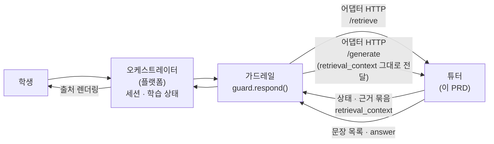
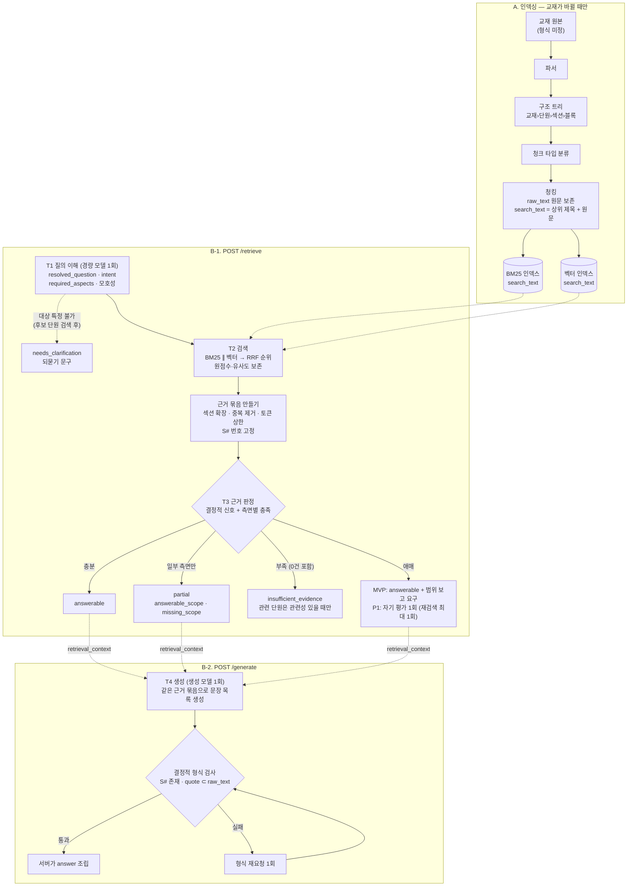

# 튜터 PRD

| 항목 | 내용 |
|---|---|
| 개발 기간 | **약 2주**: 11/9 데이터 공개 → 11/20 18:00 수치 동결 → 11/22 18:00 제출 (§2.1) |
| 담당 | 튜터 담당 |
| 바탕 | [튜터 에이전트 설계 방향](../../docs/TUTOR_AGENT_DESIGN.md), 엘리스 과제 소개(OT ppt) |
| 맞닿는 문서 | 가드레일 [PRD](../../guardrail/docs/PRD.md)·[인터페이스 제안서](../../guardrail/docs/interface.md) (main), 기획서·오케스트레이터 PRD (`docs/platform-prd` 브랜치, 머지 전) |
| 범위 | 튜터 모듈(`tutor/`)만: 교재 인덱싱, 질의 이해, 검색, 근거 판정(기권), 생성. 가드레일과 오케스트레이터는 튜터와의 입출력 계약과 연결에 필요한 만큼만 다루고, 맞닿는 항목은 §9에 제안으로만 적는다 |

> **이 문서를 읽는 법.** 내용을 네 가지로 구분한다.
>
> | 구분 | 표시 | 뜻 |
> |---|---|---|
> | 확정된 대회 요구사항 | §1.1 | OT ppt에 공개된 것. 이 문서에서 바꾸지 않는다 |
> | 튜터 담당 기본안 | 표시 없음, 또는 "기본안" | 튜터 담당의 제안. 11/9 이후 바뀔 수 있다 |
> | 대회 측 확인 사항 | `[대회 확인 O-xx]` | 대회 측 답을 받아야 정할 수 있는 것 |
> | 팀 합의 사항 | `[팀 합의 O-xx]` | 가드레일·플랫폼 담당과 합의해야 정할 수 있는 것 |
>
> 미결 항목은 모두 §12에 모았다. 데이터 형식, 모델 지원 여부, 크레딧, 성능 목표, 팀 계약은 이 문서에서 확정하지 않는다.

---

## 1. 문제

교재 근거 튜터는 다섯 가지로 실패한다.

1. **검색 실패**: 질문에 맞는 교재 부분을 못 찾거나 엉뚱한 부분을 가져온다. 근거가 틀리면 그 위에서 생성한 답도 틀린다.
2. **지어내기(할루시네이션)**: 교재에 없는 내용을 사실처럼 쓴다. 교육에서는 그대로 오개념이 된다.
3. **출처 오류**: 출처를 달지 않거나, 다른 단원을 출처로 단다.
4. **맥락 실패**: "그럼 튜플은요?" 같은 짧은 후속 질문을 앞 대화 없이 해석해 엉뚱하게 답하거나, 학생이 묻지 않은 것까지 넓혀 답한다.
5. **기권 실패**: 근거가 부족한데 지어내거나(기권 부족), 근거가 있는데 "찾지 못했다"고 한다(과잉 기권). 질문의 일부만 근거가 있을 때 전부 답하거나 전부 포기하는 것도 여기에 든다.

과제는 이 중 1~3을 직접 요구한다. 4는 제공 질의 응답 세트가 "짧은 후속 질문, 헷갈리는 부분 재질문" 같은 실제 학습자 말투를 담고 있어서 피할 수 없다. 5는 "검색된 교육 자료 청크 안에서만 답변"이라는 요구를 지키면서 정상 질문을 막지 않으려면 반드시 다뤄야 한다.

### 1.1 확정된 대회 요구사항 (OT ppt)

| 항목 | 공개된 내용 |
|---|---|
| 주제 | 교육 자료에 근거한 정확한 학습 지원과, 범위 이탈·유해 요청 차단을 동시에 달성하는 튜터 에이전트 및 가드레일 설계 |
| 학습 에이전트 | 검색된 교육 자료 청크 안에서만 답변 생성 · 모든 답변에 근거 문서와 단원 출처 명시 |
| 가드레일 모듈 | 모델 입출력 단계 등에 적용 · 생성 답변의 근거 이탈 여부와 부적절 내용 검증 |
| 교육 자료 | 에이전트가 검색하고 근거로 삼을 교재·강의 자료. 단원·섹션 구조 등 다양한 형식. **청킹 방식과 검색 전략은 참가자 자율 설계** |
| 질의 응답 세트 | 실제 학습자–튜터 대화 패턴 반영. 개념 질문, 예제 풀이, 헷갈리는 부분 재질문, 짧은 후속 질문 등 실제 학습자 말투 |
| 공격 쿼리 세트 | 범위 이탈·유해·민감 요청, 탈옥·우회 프롬프트, 정상 질문처럼 위장한 케이스 |
| 데이터 출처 | 엘리스 튜터링 에이전트 Helpy Edu의 대화 기록 기반 합성 데이터. **실제 제공되는 세부 데이터 종류와 스키마는 변동 가능** |
| 개발 환경 | Helpy Code(엘리스 클라우드에서 구동되는 프라이빗 AI 코딩 에이전트), ML API(모델 라이브러리의 여러 AI를 API로 사용) |
| 배경 | 교육 도메인에서 환각은 치명적 · 교육 AI 사용자층의 특수성 · 정확성과 안전성의 트레이드오프 · 다른 도메인 실무와도 연관된 문제 |

## 2. 목표와 비목표

| ID | 목표 |
|---|---|
| TG1 | **근거 있는 답**: 답의 사실 문장은 모두 이번 요청에서 확보한 근거 묶음으로 뒷받침된다 |
| TG2 | **정확한 출처**: 모든 사실 문장에 근거 인용(`[S#]`)이 붙고, 출처가 "교재 › 단원 › 섹션"으로 맞게 표시된다 |
| TG3 | **정직한 기권과 부분 답변**: 근거가 부족하면 생성하지 않고, 일부만 있으면 그 부분만 답하고 나머지는 확인하지 못했다고 밝힌다 |
| TG4 | **대화 이해**: 짧은 후속 질문·재질문을 앞 맥락으로 해석하되, 학생의 의도를 넓히지 않는다 |
| TG5 | **교재 인용이 달린 교수 행동**: 설명·비교·예제 풀이·확인 질문이 모두 교재 인용을 가진다 |
| TG6 | **연결 가능한 모듈**: HTTP 계약만 구현하면 오케스트레이터·가드레일에 붙는다. 가드가 없어도 혼자 돌고 평가된다 |
| TG7 | **지연·비용 보고**: 튜터 몫 지연, LLM 호출 수, 임베딩 호출 수를 요청마다 남긴다 |

**비목표**
- 가드레일 기능: 입력 검사, 검색 결과 인젝션 표시, 출력의 의미적 근거 판정, 수리, 거절·위기 문구 (가드 PRD)
- 오케스트레이터 기능: API·세션 저장, 출처 렌더링, 인용구 검증, 통합 평가, 데모 UI (오케스트레이터 PRD)
- 튜터 안의 의미적 근거 판정 모듈 (튜터는 결정적 형식 검사만 하고, 의미 판정은 가드와 평가가 맡는다)
- 학생 코드 실행 (실행 환경을 새 서비스로 붙이는 것은 2주 일정에 맞지 않는다)
- 모델 학습·파인튜닝, 자체 모델 서빙(GPU 없음)
- LLM으로 추출한 지식 그래프(GraphRAG류). 구조 트리는 출처 보존을 위해 유지하되, 다중 홉 질문이 있다는 이유만으로 그래프 검색을 도입하지 않는다. 측정에서 다중 홉 실패가 주된 실패로 확인될 때만 다시 본다 `[팀 합의 O-01]`
- 이미지·음성 입력

### 2.1 일정 제약: 2주

실제 데이터는 11/9에 나오고 수치는 11/20에 동결한다. 실제 데이터로 개발할 수 있는 날은 **12일 남짓**이다. 그래서 이 PRD는 다음 규칙으로 범위를 잡는다.

1. **걷는 뼈대 먼저 (11/11까지).** 질문 → 검색 → (근거 부족이면 기권 / 있으면 인용 답변)이 끝까지 도는 가장 단순한 버전(MVP)을 먼저 만든다. 각 요구사항의 **MVP** 표시가 그 버전에 들어갈 최소 구현이다. 임베딩 준비가 늦으면 BM25 단독으로 먼저 완주한다.
2. **측정한 실패만 고친다.** MVP 뒤의 개선은 **11/13 통합 1차와 하네스에서 확인한 실패 유형** 순서대로, 한 번에 하나씩 한다. 우선 후보는 비교·후속 질문과 인용 안정성이다. 리랭커·자기 평가·요약 노드는 필요성이 측정될 때만 추가한다.
3. **11/17 기능 범위 고정 (기본안).** 11/17 이후에는 새 기능을 넣지 않고 임계값 보정, 회귀 확인, 최종 평가만 한다 `[팀 합의 O-09]`.
4. **설정으로 바꿀 수 있게만 만든다.** 미결 정책(정답 제공, 근거 기반 추론의 범위 등)은 코드를 두 번 쓰지 않도록 설정값으로 받는다. 11/9 이후 결정이 바뀌어도 설정만 바꾼다.
5. **있는 것을 쓴다.** 데이터 공개 전에는 가드 저장소의 모의 튜터·대체 교재로 개발한다. 모델 호출·서비스·프레임워크는 2주 안에 꼭 필요한 이유가 있을 때만 추가하고, 그 이유를 해당 요구사항에 적는다.

**시간이 모자랄 때 자르는 순서** (앞부터 자른다)

| 순서 | 자를 것 | 잘랐을 때 대신 |
|---|---|---|
| 1 | 요약 노드 (TU-05), 학습 순서 추천 (SC-22) | 단원 제목 목록만 안내 |
| 2 | 퀴즈 답 채점 (SC-20) | 확인 질문만 생성 |
| 3 | 여러 질문 분해 (SC-25) | 첫 질문에 답하고 나머지는 다시 물어 달라고 안내 |
| 4 | 리랭커 (TU-07) | RRF 결합 순위 |
| 5 | 기권 게이트 자기 평가 (TU-08) | 결정적 신호 + 생성 단계의 범위 보고(MVP 방식) |
| 6 | 유형별 교수 템플릿 세분화 (TU-10) | 공통 템플릿 1개 + 비교 템플릿 |
| 7 | 청크 타입 분류의 모델 사용 (TU-02) | 규칙 분류만 |

**자르지 않는 것**: 원문(`raw_text`)과 검색용 텍스트 분리, 문장별 근거 인용과 quote, 결정적 형식 검사, 근거 판정 상태(답변 가능·부분·확인 필요·근거 부족), 후속 질문 해석, HTTP 계약, 튜터 하네스.

## 3. 사용자와 시나리오

| 사용자 | 튜터에 바라는 것 |
|---|---|
| 학생 (연령대 `[대회 확인 O-08]`) | 개념 질문, 예제 풀이, 헷갈리는 부분 재질문, 짧은 후속 질문에 교재 근거가 달린 답을 받는다 |
| 오케스트레이터 (플랫폼) | `/retrieve`·`/generate`를 부르면 정해진 형식으로 근거 묶음과 답을 받는다 |
| 가드레일 | 답의 `[S#]` 인용과 원문으로 문장–근거를 판정할 수 있다 |
| 심사위원·팀 | 튜터 단독 수치(검색·근거·인용·기권)와 가드 결합 후 수치를 나눠 본다 |

### 3.1 시나리오 목록

교재 과목은 아직 모르므로 예시는 OT 예시 화면에 나온 파이썬 기초(리스트·튜플)로 든다 `[대회 확인 O-02]`. **우선**은 2주 일정 기준이다(§2.1). MVP = 11/11 걷는 뼈대에 포함, P1 = 11/17 기능 고정 전, P2 = 측정으로 필요가 확인되고 시간이 남으면. **상태**는 §5 TU-08의 근거 판정 상태다.

**A. 기본 학습 질문** (제공 질의 응답 세트의 질문 유형)

| ID | 상황 | 예시 | 기대 동작 | 상태 | 단계 | 우선 |
|---|---|---|---|---|---|---|
| SC-01 | 개념 정의 | "리스트가 뭐예요?" | 정의 섹션 인용 + 교재 예시 | 답변 가능 | T2·T4 | MVP |
| SC-02 | 예제·코드 설명 | "교재 3-2 예제 실행하면 뭐가 나와요?" | 예제·코드 청크 우선 검색. 실행 결과는 교재에 적힌 것만 인용하고, 없으면 직접 실행해 보도록 안내 | 답변 가능 / 부분 | T2·T4 | MVP |
| SC-03 | 두 개념 비교 | "리스트랑 튜플 뭐가 달라요?" | 양쪽 근거를 모두 확보했을 때만 비교. 한쪽만 있으면 부분 답변 | 답변 가능 / 부분 | T1·T3·T4 | MVP |
| SC-04 | 헷갈리는 부분 재질문 | "아까 그 mutable이 무슨 뜻인지 모르겠어요" | 같은 근거를 더 쉬운 표현으로 재진술하거나 관련 섹션의 다른 교재 예시로 | 답변 가능 | T1·T4 | P1 |
| SC-05 | 짧은 후속 질문 | (직전: "리스트에 append로 값을 추가할 수 있나요?") "그럼 튜플은요?" | 직전 질문의 동작(append로 값 추가)을 이어받아 "튜플에도 append로 값을 추가할 수 있나요?"로 해석. 정의·비교로 넓히지 않음 | 답변 가능 | T1 | MVP |
| SC-06 | 단원 요약 | "3단원 정리해 줘" | 요약 노드가 있으면 사용, 없으면 섹션 제목 + 핵심 원문 문장 인용 | 답변 가능 | T2·T4 | P2 |

**B. 대화 맥락**

| ID | 상황 | 예시 | 기대 동작 | 상태 | 단계 | 우선 |
|---|---|---|---|---|---|---|
| SC-07 | 지시어·생략 | "그거 다시 설명해 줘" | 직전 답의 주제로 복원. 대상이 둘 이상이거나 불확실하면 되묻기 | 답변 가능 / 확인 필요 | T1 | P1 |
| SC-08 | 교재 안 주제 전환 | (리스트 얘기 중) "이제 반복문 알려 주세요" | 앞 주제와 직전 근거를 끌고 오지 않고 새 주제로 검색 | 답변 가능 | T1 | P1 |
| SC-09 | 긴 대화 속 후속 | 5턴 넘게 이어진 뒤 "처음에 말한 거요" | 최근 N턴 + 요약으로 복원을 시도하고, 특정하지 못하면 되묻기 | 확인 필요 | T1 | P2 |
| SC-10 | 틀린 전제 | "튜플도 append 되죠?" | 전제를 교재 근거로 바로잡는다 (가드 범주 S13과 맞춤) | 답변 가능 | T2·T4 | P1 |

**C. 학생 코드·오류**

| ID | 상황 | 예시 | 기대 동작 | 상태 | 단계 | 우선 |
|---|---|---|---|---|---|---|
| SC-11 | 학생 코드 + "왜 에러나요?" | `t = (1, 2)`<br>`t[0] = 5` | 코드를 실행하지 않는다. 관련 교재 규칙을 인용하고, 그 규칙을 학생 코드에 적용한 설명은 "교재의 ○○ 규칙에 따르면"처럼 근거와 함께 쓴다(TU-10 경계) | 답변 가능 / 부분 | T1·T2·T4 | P1 |
| SC-12 | 오류 메시지만 | "TypeError: 'tuple' object does not support item assignment" | 오류 메시지의 핵심 용어로 검색해 해당 개념 섹션 인용. 오류 메시지 자체가 교재에 없으면 개념 근거로만 설명 | 답변 가능 / 부분 | T1·T2 | P1 |

**D. 교재 경계**

| ID | 상황 | 예시 | 기대 동작 | 상태 | 단계 | 우선 |
|---|---|---|---|---|---|---|
| SC-13 | 같은 과목이지만 근거를 찾지 못함 | "파이썬으로 웹 크롤링 하는 법" | 생성하지 않는다. "지금 찾은 교재 내용으로는 답할 근거를 찾지 못했어요"로 안내하고, 관련성이 있는 단원이 있을 때만 그 단원을 함께 안내 | 근거 부족 | T3 | MVP |
| SC-14 | 질문의 일부만 근거 있음 | "중첩 리스트 컴프리헨션은요?" (기본형만 교재에 있음) | 근거가 있는 부분만 인용해 답하고, 나머지는 "찾은 교재 근거로는 확인하지 못했다"고 밝힘 | 부분 | T3·T4 | P1 |
| SC-15 | 교재 밖 일반 지식 | "파이썬은 누가 만들었어요?" | 근거를 찾지 못하면 기권. 대회 측이 명시적으로 예외를 허용하기 전까지 일반 지식으로 답하지 않음 `[대회 확인 O-11]` | 근거 부족 | T3 | MVP |
| SC-16 | 다른 과목·잡담 | "오늘 점심 뭐 먹지?" | 가드가 교육적 전환으로 처리. 튜터는 받은 `instruction`만 따른다 | — | 가드 | — |
| SC-17 | 맥락 없는 모호한 질문 | (첫 턴) "이거 어떻게 해요?" | 지시 대상을 특정할 수 없으므로 되묻기. 관련성 있는 후보 단원이 있으면 2~3개를 보기로 제시 | 확인 필요 | T1 | P1 |

**E. 교수 행동**

| ID | 상황 | 예시 | 기대 동작 | 상태 | 단계 | 우선 |
|---|---|---|---|---|---|---|
| SC-18 | 정답만 요구 | "풀이 말고 답만 알려 줘" | 정답 제공 정책을 설정으로 따른다 `[팀 합의 O-10]` | 답변 가능 | T4 | P1 |
| SC-19 | 확인 질문·퀴즈 요청 | "문제 내 줘" | MVP는 교재 내용에 가까운 확인 질문(교재 예제·연습문제 변형). 문항·정답·해설 각각에 인용 | 답변 가능 | T4 | MVP |
| SC-20 | 퀴즈 답 제출 | "1번이요" | 직전 퀴즈 정답(교재 인용)과 대조해 피드백. 직전 퀴즈를 누가 기억하는지 `[팀 합의 O-04]` | 답변 가능 | T4 | P2 |
| SC-21 | 수준 맞춤 요청 | "처음 배우는데 쉽게 설명해 줘" | 같은 근거·인용으로 표현만 쉽게 (`learner_hints`의 수준 값) | 답변 가능 | T4 | P1 |
| SC-22 | 학습 순서 질문 | "뭐부터 공부해야 해요?" | 구조 트리의 단원 순서로 안내. 선수 관계는 교재에 명시된 경우만 `[팀 합의 O-04]` | 답변 가능 | T2 | P2 |

**F. 입력 형태**

| ID | 상황 | 예시 | 기대 동작 | 상태 | 단계 | 우선 |
|---|---|---|---|---|---|---|
| SC-23 | 구어체·오타·반말 | "리스트ㅋㅋ 그거 뭐임" | T1이 의도를 유지한 채 정리한 뒤 검색 | 답변 가능 | T1 | MVP |
| SC-24 | 코드 식별자·영어 섞임 | "append랑 extend 차이" | BM25로 식별자를 정확히 잡고, 양쪽 근거 확보 여부 확인 | 답변 가능 / 부분 | T2·T3 | MVP |
| SC-25 | 한 번에 여러 질문 | "리스트, 튜플, 딕셔너리 정의 다 알려 줘" | 하위 질의로 나눠 각각 검색·인용 | 답변 가능 / 부분 | T1·T2 | P2 |
| SC-26 | 아주 긴 입력 | 코드 200줄 붙여 넣기 | 질문 부분과 코드 앞부분만 T1 입력에 쓰고 길이 상한을 둔다 | 답변 가능 / 확인 필요 | T1 | P1 |

**G. 가드레일이 먼저 처리하는 상황** (튜터는 결과를 따른다)

| ID | 상황 | 튜터에게 오는 것 | 튜터가 할 일 |
|---|---|---|---|
| SC-27 | 탈옥·인젝션·유해 요청 | 가드가 차단하면 생성 결과가 버려짐 | 없음. `/retrieve`는 가드 입력 판정과 동시에 돌 수 있다 |
| SC-28 | 교재 청크 속 숨은 지시문 | 가드가 표시한 근거 + `system_extra` 안내 | 표시된 지시를 따르지 않음. quote는 원문 기준으로 씀(O-20) |
| SC-29 | 전환·부분 응답 | `instruction` (예: 원리만, 실행 절차 제외) | 같은 근거 묶음으로 지시대로 다시 생성 |
| SC-30 | 근거 부족 재생성 | `/generate`를 피드백 `instruction`과 함께 다시 호출 | 같은 근거 묶음 안에서 지적된 문장을 다시 씀. 재검색하지 않음 |
| SC-31 | 위기 발화 | 가드가 위기 템플릿으로 응답, 생성 결과 버림 | 없음 |

**H. 장애** (지식 부족 기권과 구분한다)

| ID | 상황 | 기대 동작 | 생성 호출 | 우선 |
|---|---|---|---|---|
| SC-32 | 인덱스 미적재·손상 | HTTP 503 `INDEX_NOT_READY`, `/health`에 상태 표시. 기권 상태로 위장하지 않음 | 없음 | MVP |
| SC-33 | LLM·임베딩 호출 타임아웃·오류 | HTTP 오류(`UPSTREAM_TIMEOUT` 등)를 돌려줌 → 어댑터·가드가 안전 응답 | 없음 | MVP |
| SC-34 | 생성 형식 위반 (`[S#]` 누락, 없는 번호, quote 불일치) | 결정적 형식 검사 후 1회 재요청, 그래도 실패하면 HTTP 오류 `GENERATION_FORMAT_ERROR` | 재요청 1회 | MVP |
| SC-35 | 정상 검색이 결과 0건 | 장애가 아니라 근거 부족 상태(`insufficient_evidence`), 관련 단원 없음 | 없음 | MVP |

### 3.2 11/9 OT 이후 시나리오 추가

OT·데이터 공개에서 상황이 더 나올 수 있다 `[대회 확인 O-16]`. 그때 PRD 구조를 다시 짜지 않도록 아래 절차로 받는다.

1. **분류.** 새 상황이 기존 SC 중 하나에 해당하면 시나리오는 늘리지 않고 평가 세트에 사례만 추가한다.
2. **새 SC 추가.** 해당이 없으면 SC-4x부터 번호를 붙이고, **담당**(튜터 / 가드 / 플랫폼), **단계**(T1~T4), **근거 판정 상태**를 정한다. 튜터 몫이면 관련 요구사항(TU-xx)에 한 줄 추가한다.
3. **우선순위.** 2주 일정 안에서 정한다. 제공 평가 데이터에 자주 나오면 P1로 올리고, 드물면 P2로 두거나 발표 자료의 설계로만 다룬다. 11/17 이후에 나온 상황은 기능 추가 없이 기존 경로(기권·되묻기)로 처리되는지만 확인한다.
4. **코드 영향 최소화.** 질문 유형 목록과 응답 템플릿은 설정 파일에 둔다. 새 유형은 설정에 추가하고, 분류되지 않는 질문은 "기타" 유형의 공통 템플릿(인용 달린 설명)으로 받는다.

**OT에서 확인할 예상 후보** (나오면 SC로 추가)

| 후보 | 영향 |
|---|---|
| 교재가 여러 권·여러 과목 | 교재 간 혼동, 출처에 교재 이름 필수, 과목 필터 |
| 표·그림·수식이 많은 교재 | 파서, 그림 설명이 없을 때의 근거 부족 처리 |
| 노트북·실습 코드 형식 교재 | 코드 셀 청킹, 실행 결과 셀을 원문으로 다룰지 |
| 평가셋의 다회차 대화 형식 | T1 재작성 평가 방식 |
| 실습 과제·시험 대비 질문 | 정답 제공 정책과 연결 `[팀 합의 O-10]` |
| 질의 응답 세트에 정답 근거 위치 표시 여부 | 검색 재현율 측정 방식 `[대회 확인 O-02]` |

---

## 4. 아키텍처

### 4.1 전체 시스템에서 튜터의 자리



튜터는 **요청의 가운데**만 맡는다. 앞뒤 검사는 가드레일이, 세션과 화면 표시는 오케스트레이터가 한다. 튜터는 요청마다 필요한 것(질문, 대화 이력, 지시, 학습 상태 힌트)을 받아 결과를 돌려주고 **상태를 저장하지 않는다**(stateless). `/retrieve`의 해석 결과는 `retrieval_context`에 담아 돌려주고, 어댑터가 그것을 `/generate`에 그대로 넘긴다. 그래서 튜터가 요청 사이에 아무것도 기억하지 않아도 T1의 해석이 T4까지 이어진다 (제안 `[팀 합의 O-07]`).

### 4.2 튜터 내부: 미리 준비하는 길과 질문마다 도는 길



- `/generate`는 `answerable`·`partial`(애매 구간 포함)일 때만 불린다.
- 인덱스 미적재·서비스 오류는 위 상태 분기에 들어가지 않고 HTTP 오류로 끝난다(§5 TU-11).
- `needs_clarification`과 `insufficient_evidence`에서는 `/generate`를 부르지 않는다. 안내 문구는 `/retrieve` 응답에 담겨 나간다(제안 `[팀 합의 O-07]`).

### 4.3 쉽게 설명하면

튜터를 **교재 한 권만 펼쳐 놓고 답하는 조교**라고 생각하면 된다.

- **A. 인덱싱 = 교재에 색인과 포스트잇을 붙여 두는 일.** 교재를 단원·섹션별로 나누고, 각 조각이 개념 설명인지 예제인지 표시해 둔다. 조각마다 "몇 단원 몇 절"인지 꼬리표를 단다. 이때 **교재 원문(`raw_text`)은 그대로 보관**하고, 찾기 쉽게 상위 제목을 붙인 사본(`search_text`)은 색인에만 쓴다. 나중에 인용할 때는 반드시 원문만 쓴다. 찾는 방법은 두 가지로 준비한다. 단어가 똑같이 들어 있는지로 찾는 색인(BM25)과 뜻이 비슷한지로 찾는 색인(벡터)이다. 코딩 교재는 `append` 같은 정확한 단어도, "값 추가하는 법" 같은 풀어 쓴 질문도 잡아야 해서 둘 다 쓴다.
- **T1 질의 이해 = 질문을 다시 정리해서 듣기.** 학생이 "그럼 튜플은요?"라고만 하면, 직전에 물은 것이 "append로 값을 추가할 수 있나"였다면 "튜플에도 append로 값을 추가할 수 있나요?"로 정리한다. 학생이 묻지 않은 "튜플이란 무엇이고 리스트와 어떻게 다른가"로 넓히지 않는다. 무엇을 가리키는지 정말 알 수 없으면 되묻는다.
- **T2 검색 = 교재에서 해당 부분 찾기.** 두 색인에서 후보를 찾아 순위를 합친다. 순위를 합친 점수는 "어느 것이 더 관련 있나"를 정할 뿐 "답할 수 있나"를 말해 주지 않는다. 그래서 원래 점수도 함께 보관한다. 고른 조각은 주변 문맥을 붙이고 겹치는 것을 빼서 하나의 **근거 묶음**으로 만든다.
- **T3 근거 판정 = "이걸로 답할 수 있나?" 먼저 확인.** 질문이 필요로 하는 것(비교면 양쪽 모두)이 근거 묶음에 다 있는지 본다. 다 있으면 답하고, 일부만 있으면 그 부분만 답하고, 없으면 **답을 쓰지 않고** "지금 찾은 교재 내용으로는 답할 근거를 찾지 못했어요"라고 돌려준다. 검색에서 못 찾았다고 "교재에 없다"고 단정하지 않는다. 비슷한 단원이 정말 관련 있을 때만 그 단원을 안내한다.
- **T4 생성 = 찾은 페이지를 짚어 가며 설명하기.** T3가 본 **같은 근거 묶음**만 보고, 문장 목록을 만든다. 문장마다 어느 조각(`[S1]`)에서 왔는지와 그 조각 원문의 한 구절(quote)을 단다. 서버가 그 목록으로 최종 답을 이어 붙이므로, 화면의 답과 인용 목록이 서로 어긋나지 않는다. 오케스트레이터와 가드레일은 이 인용으로 근거를 확인한다.

**한 번의 요청을 따라가 보면** ("리스트에 append로 값을 추가할 수 있나요?" 다음에 "그럼 튜플은요?")

1. 가드레일(어댑터)이 대화 이력과 함께 `/retrieve`를 부른다. 가드레일 입력 검사는 이와 **동시에** 돈다.
2. T1이 원래 질문 "그럼 튜플은요?"를 보존하고, 직전 질문의 동작을 이어받아 `resolved_question`을 "튜플에도 append로 값을 추가할 수 있나요?"로 만든다. `intent`는 `followup`, 필요한 측면은 "튜플에 append 가능 여부" 하나다.
3. T2가 "튜플" 섹션을 찾고, 근거 묶음을 만들며 `S1`을 붙인다.
4. T3가 측면이 근거로 충족되는지 확인해 `answerable`로 판정하고, `retrieval_context`와 함께 돌려준다.
5. 가드레일이 근거에 숨은 지시문이 있는지 표시한 뒤, 어댑터가 `retrieval_context`를 그대로 실어 `/generate`를 부른다.
6. T4가 문장 목록을 만든다: "튜플은 한 번 만들면 값을 바꿀 수 없습니다." (근거 S1, quote는 S1 원문의 한 구절), "그래서 리스트처럼 append로 값을 추가할 수는 없습니다." (근거 S1, 교재 규칙을 적용한 설명). 서버가 형식을 검사하고 `answer`를 조립한다.
7. 오케스트레이터가 quote를 대조하고, 가드레일이 출력을 판정한 뒤, 화면에는 `[S1]`이 "파이썬 기초 › 3. 자료형 › 3.3 튜플"로 바뀌어 보인다.

근거가 부족하면 4에서 `insufficient_evidence`가 나가고 5~6의 생성은 일어나지 않는다. 그만큼 호출 수와 지연도 준다.

### 4.4 설계 원칙

1. **처음엔 고정 파이프라인.** 매 턴 모델이 도구를 고르는 에이전트 구조는 통제 지점과 호출 수만 늘린다. 필요가 측정되면 그때 바꾼다.
2. **구조를 잃지 않는다.** 출처 표시가 필수이므로 형식이 무엇이든 단원·섹션 구조를 보존한다.
3. **원문과 검색용 텍스트를 섞지 않는다.** 인용과 quote 대조는 교재 원문(`raw_text`)으로만 한다. 상위 제목이나 생성 요약은 검색을 돕는 데만 쓴다.
4. **순위와 답변 가능성을 구분한다.** 검색 결합 점수는 순위용이고, 답변 가능 판정은 보존한 원점수·유사도·측면별 충족으로 따로 한다. 높은 관련성이 필요한 근거의 충분성을 보장하지 않는다.
5. **근거가 없으면 생성하지 않는다.** 기권은 생성 프롬프트의 지시가 아니라 검색 단계의 판정으로 한다. 단, 검색 실패를 "교재에 없음"으로 단정하지 않는다.
6. **판정한 근거로 생성한다.** T3가 판정한 근거 묶음과 T4가 쓰는 근거 묶음, `[S#]` 번호는 한 요청 안에서 같다.
7. **확인할 수 있게 쓴다.** 문장마다 인용과 원문 quote를 달아, 다른 모듈이 LLM 없이도 대조할 수 있게 한다. quote가 원문에 있는지(결정적 검사)와 그 quote가 문장을 실제로 뒷받침하는지(의미 판정)는 다른 문제이고, 뒤의 것은 가드와 평가가 본다.
8. **튜터는 상태를 갖지 않는다.** 세션·학습 상태는 오케스트레이터가 갖고 요청마다 넘겨준다 `[팀 합의 O-04]`.
9. **가드가 잡을 일을 줄인다.** 사후 탐지·수리는 가드레일 몫이지만, 튜터가 많이 새면 수리·기권이 늘어 정상 답의 품질과 지연이 함께 나빠진다. 그래서 튜터는 생성 전·생성 중에 지어내기를 **줄이는** 수단을 쓰고, 그 효과는 하네스로 잰다(§5 TU-09).

---

## 5. 기능 요구사항

우선순위: **P0** 제출에 필수 / **P1** 점수에 직접 기여, 11/17 기능 고정 전 / **P2** 측정으로 필요가 확인되고 시간이 남으면. 수용 기준의 수치는 모델·데이터 확인과 11/13 통합 1차 뒤 팀 합격선과 함께 정한다 `[팀 합의 O-12]`.
**MVP**는 11/11 걷는 뼈대에 넣을 최소 구현이다(§2.1). P0 요구사항도 MVP 이후 부분은 측정 결과를 보고 채운다.

### A. 인덱싱

#### TU-01 파서와 구조 트리 (P0)
- 교재 원본을 형식과 상관없이 `교재 → 단원 → 섹션 → 블록(설명 / 예제 코드 / 표)` 트리로 바꾼다.
- 형식별 파서를 따로 두고 뒤 단계는 트리만 본다. 형식이 바뀌어도 파서만 고친다.
- 블록마다 원문 위치(`source_locator`: 교재, 단원, 섹션, 페이지 또는 원문 내 구간)를 기록한다. 출처 표시와 정답 근거 라벨이 이 위치를 쓴다.
- 형식: `[대회 확인 O-02]` (11/9 데이터 공개 후). 그 전에는 자리표시 교재로 개발한다.
- 구조 그래프(용어 정의 위치, 선수 관계 포함)를 튜터가 만들지 플랫폼이 만들지 `[팀 합의 O-04]` (오케스트레이터 PRD TU-P1).
- **MVP**: 제공 형식 하나만, 제목·번호 패턴으로 단원·섹션을 뽑는다. 형식이 복잡하면 1일 타임박스 뒤 "텍스트 + 제목 계층"으로 단순화한다.
- **수용 기준**: 제공 교재 전체에서 모든 블록이 단원·섹션·원문 위치를 가진다(누락 0). 파싱 결과를 사람이 단원 5개 이상 표본 검토.

#### TU-02 청크 타입 분류 (P0)
- 블록을 개념 / 정의 / 예제 / 코드 / 연습문제로 분류한다. 규칙(제목·코드 블록·번호 패턴) 우선, 안 되면 경량 모델.
- 유형별 검색(예제 우선, 정의 대조)에 쓴다.
- **MVP**: 규칙으로 코드 / 설명 두 가지만 나눈다. 나머지 타입은 P1, 모델 사용은 자르는 순서 7.
- **수용 기준**: 표본 100블록 사람 라벨 대비 정확도 보고.

#### TU-03 청킹과 원문 보존 (P0)
- 섹션 단위로 자르고, 길면 블록 단위로 나누며 겹침(overlap)을 둔다. 예제 코드는 자르지 않고 바로 앞 설명과 한 청크로 묶는다.
- 청크마다 역할이 다른 필드를 분리한다(필드 이름은 계약에 맞춰 조정 가능 `[팀 합의 O-07]`).

| 필드 | 내용 | 쓰는 곳 |
|---|---|---|
| `chunk_id` | 청크 식별자 (재인덱싱해도 같은 원문 위치면 같게) | 근거 묶음, 로그 |
| `raw_text` | 교재에서 추출한 원문. 가공하지 않음 | **T4 생성 입력, quote 대조, 가드에 넘기는 근거 텍스트** |
| `search_text` | `raw_text` 앞에 상위 단원·섹션 제목(선택: 섹션 요약)을 붙인 검색용 텍스트 | BM25·벡터 인덱스만 |
| `source_locator` | 교재 · 단원 · 섹션 · 페이지 또는 원문 내 구간 | 출처 렌더링, 정답 근거 라벨 대조 |
| `block_type` | TU-02 결과 | 유형별 검색 |

- **생성 요약은 원문이 아니다.** 섹션 요약을 만들더라도 `search_text`에만 넣고, quote 대조 대상이나 생성 입력의 인용 가능한 텍스트로 쓰지 않는다. 제목은 T4에 "어느 섹션인지" 알리는 표시로만 준다.
- 출처 표기 형식은 팀 공통 결정 C8 `[팀 합의 O-05]`.
- **MVP**: 섹션 단위 + 고정 길이 분할, 코드 블록 보존, `search_text`는 상위 제목 보강만. 생성 요약 추가는 선택 기능(P2, TU-05와 함께).
- **수용 기준**: 코드 블록이 잘린 청크 0개. 모든 청크에서 `raw_text`가 원본 교재의 연속 구간과 일치. 청크 길이 분포와 크기·겹침 설정을 결과에 기록.

#### TU-04 하이브리드 인덱스 (P0)
- `search_text`로 BM25 인덱스와 벡터 인덱스를 만든다. 시작할 때 메모리에 올린다.
- 임베딩 모델: **엘리스 ML API의 임베딩 모델 제공 여부를 11/9 대회 측에 물어본 뒤 정한다** `[대회 확인 O-03]`. 제공하지 않으면 로컬(CPU) 한국어 임베딩 모델을 후보로 비교한다. API를 쓰면 인덱싱 때 청크 수만큼, 요청마다 질의 1건의 임베딩 호출이 생긴다(§6).
- 벡터 저장소 종류(FAISS 파일, Chroma 등): 팀 공통 결정 C3 `[팀 합의 O-05]`. 2주 일정에서는 별도 서버가 필요 없는 파일·메모리 방식을 기본안으로 둔다.
- 인덱싱은 CLI로 실행하고(선택: `POST /ingest`), 교재 해시와 설정을 결과에 남긴다.
- **MVP**: BM25 인덱스 먼저. 임베딩 모델이 정해지면 벡터 인덱스를 추가한다. 임베딩 준비가 늦어도 BM25 단독으로 MVP를 완주한다.
- **수용 기준**: 같은 교재·설정으로 다시 인덱싱하면 같은 결과. 인덱싱 시간과 크기 보고.

#### TU-05 요약 노드 (P2)
- 단원·섹션 요약을 별도 노드로 두어 "이 단원 정리해 줘" 같은 질문(SC-06)에 쓴다.
- 요약은 검색용이며 인용 원문이 아니다(TU-03). 답변의 사실 문장은 요약이 가리키는 원문 청크로 인용한다.
- 단원 요약 질문의 실패가 측정으로 확인될 때만 만든다(자르는 순서 1).

### B. 질문 처리

#### TU-06 T1 질의 이해 (P0)
- 입력: 원래 질문 + 최근 대화 이력(오케스트레이터가 넘김, 최근 N턴 + 요약).
- **경량 모델 1회**로 아래를 한꺼번에 낸다(별도 호출을 늘리지 않는다).

| 출력 | 뜻 |
|---|---|
| `original_question` | 학생이 쓴 그대로 (보존) |
| `resolved_question` | 지시어·생략을 앞 맥락으로 채운 독립 질의 |
| `intent` | `concept` 개념 / `example` 예제 풀이 / `compare` 재질문(비교) / `followup` 짧은 후속 / `quiz` 확인 질문 요청 / `other` 기타 |
| `required_aspects` | 답에 필요한 측면 목록 (예: 비교면 "리스트의 ○○", "튜플의 ○○") |
| `context_link` | `continue`(앞 주제 이어짐) / `new_topic`(주제 전환) |
| `ambiguity` | 지시 대상을 특정할 수 없으면 `true` + 되묻기 문구 1개 + 후보 대상 |

- **재작성 규칙: 의도를 넓히지 않는다.**
  - 원래 질문에 없는 대상·측면은 **직전 대화에서 학생이 실제로 물은 것만** 채운다. "그럼 튜플은요?"는 직전 질문이 묻던 속성이나 동작(예: append로 값 추가)을 이어받고, 정의·비교 같은 새 측면을 덧붙이지 않는다.
  - 직전 질문이 무엇을 물었는지 둘 이상으로 읽히면 넓게 합치지 않고 `ambiguity=true`로 되묻는다.
  - `required_aspects`는 `resolved_question`에 있는 것만 넣는다.
- **모호성은 T1에서 판단한다.** `ambiguity=true`면 `/retrieve`는 검색 결과와 상관없이 `needs_clarification`을 돌려준다. 후보 단원은 검색 결과가 관련성 기준을 넘을 때만 보기로 붙인다.
- **재작성 실패와 직전 근거 재사용.** 직전 근거를 자동으로 다시 쓰면 주제가 바뀐 질문에 엉뚱한 근거로 답할 위험이 크다(SC-08). 그래서:
  - T1이 실패(오류·타임아웃·형식 오류)하면 **원래 질문 그대로** 검색하고 직전 근거는 쓰지 않는다. 그 결과로 T3가 판정한다.
  - 직전 근거(`last_chunks`)는 T1이 `context_link=continue`라고 판단했고 질문에 새 핵심 용어가 없을 때만 **검색 후보에 추가**한다. 이 경우에도 T3 판정을 거친다(P1).
- 명확한 독립 질문(첫 턴, 지시어 없음)은 T1을 생략하고 규칙으로 유형만 붙이는 최적화를 검토할 수 있다(선택, §6).
- 유형 분류 결과를 교수 전략 선택에 어떻게 쓰는지는 §9 D-T4 `[팀 합의 O-06]`.
- 관련 시나리오: SC-04·05·07~09·11·12·17·23·25·26.
- **MVP**: 위 출력 전체를 경량 모델 1회로 JSON으로 받는다. 실패 시 원래 질문으로 검색. `last_chunks` 재사용, 캐시, 여러 질문 분해(SC-25)는 뒤로.
- **수용 기준**: 후속 질문 표본에서 재작성 후 검색 재현율이 재작성 전보다 높다. 재작성이 의도를 넓힌 사례 비율(사람 검토) 보고. 유형 분류 정확도와 되묻기 비율 보고.

#### TU-07 T2 검색과 근거 묶음 (P0)
- `resolved_question`으로 BM25와 벡터 검색을 병렬로 돌린다.
- **순위 결합: RRF(Reciprocal Rank Fusion)를 기본 후보로 둔다.** 두 결과의 순위만으로 합치므로 점수 척도를 맞출 필요가 없고 구현이 간단하다. RRF 점수는 **순위용**이며, 답변 가능성의 확률로 쓰지 않는다.
- **기권 판정용 신호를 보존한다.** 후보마다 BM25 원점수, 벡터 유사도(코사인 원값), 각 검색에서의 순위를 그대로 남겨 T3에 넘긴다.
- 검색 힌트를 반영한다: 예제 우선, 비교면 측면별 검색(두 개념 각각), `context_link=continue`면 직전 근거 후보 추가. 힌트는 T1 결과에서 온다.
- **근거 묶음 만들기.** 상위 후보를 → 상위 섹션 확장(같은 섹션의 앞뒤 블록) → 중복·겹침 제거 → 토큰 상한 적용 순으로 정리해 **최종 근거 묶음**을 만든다. 묶음 안의 순서대로 `S1, S2, …`를 붙이고 이 번호를 요청 끝까지 고정한다.
- top-k는 3~5에서 시작한다.
- **MVP**: RRF top-k + 중복 제거 + 토큰 상한. 벡터가 없으면 BM25 순위만. 상위 섹션 확장·측면별 검색은 P1(비교·후속 질문 개선과 함께), 리랭커는 측정으로 필요가 확인될 때(자르는 순서 4).
- **수용 기준**: 질의 응답 세트에서 검색 재현율@k(§7) 보고. 상위 섹션 확장·리랭커를 추가한다면 켬/끔 비교.

#### TU-08 T3 근거 판정 (P0)
T3는 **최종 근거 묶음**이 `required_aspects`를 답할 만큼 갖췄는지 판정한다. 검색 관련성과 근거 충분성은 다르다. 예를 들어 "중첩 리스트 컴프리헨션"을 물었을 때 기본 컴프리헨션 섹션은 관련성이 높게 나오지만, 중첩 형태의 근거는 없을 수 있다.

**왜 정규화 점수로 기권하지 않는가.** 질의마다 min-max 정규화를 하면 그 질의의 1등은 관련이 없어도 항상 1.0이 된다. 그래서 "정규화 점수 < θ면 기권" 같은 공통 임계값은 관련 없는 질문에서도 기권하지 못한다. RRF 점수도 순위만 반영하므로 같은 문제가 있다. 그래서 기권은 질의 사이에 비교 가능한 **절대 신호**로 판정한다.

**판정에 쓰는 신호** (모델 호출 없이 계산)

| 신호 | 계산 |
|---|---|
| 최고 벡터 유사도 | 근거 묶음 안 코사인 유사도의 최댓값 (벡터가 있을 때) |
| 최고 BM25 원점수 | 근거 묶음 안 BM25 원점수의 최댓값 |
| 측면별 충족 | `required_aspects`마다, 그 측면의 핵심 용어·식별자가 근거 묶음의 `raw_text`에 있는지 + 측면별 최고 유사도 |

**상태** (`retrieval_status`)

| 상태 | 조건 (기본안) | `/generate` 호출 | 학생에게 가는 것 |
|---|---|---|---|
| `answerable` 답변 가능 | 모든 측면 충족, 신호가 상단 구간 | 함 | 인용 답변 |
| `partial` 부분 답변 가능 | 일부 측면만 충족 | 함 (`answerable_scope`·`missing_scope` 전달) | 충족된 부분만 답 + 부족한 범위 안내 |
| `needs_clarification` 질문 확인 필요 | T1 `ambiguity=true` | 안 함 | 되묻기 문구 (+ 관련성 있는 후보 단원) |
| `insufficient_evidence` 확보한 근거 부족 | 충족 측면 없음, 또는 신호가 하단 구간, 또는 검색 결과 0건 | 안 함 | 근거 부족 안내 (+ 관련성 있는 단원만) |

- 상단·하단 구간 사이는 **애매** 구간이다.
  - **MVP 기본안**: 애매 구간은 `answerable`로 넘기되 `evidence_check=required`를 붙인다(상단 구간은 `evidence_check=none`). T4는 같은 생성 호출 안에서 측면별로 "근거로 답함 / 근거 없음"을 보고한다(`coverage`). 서버는 모든 측면이 "근거 없음"이면 생성 결과를 버리고 `insufficient_evidence` 안내로, 일부만이면 `partial` 형태로 바꾼다. **추가 모델 호출은 없다.** 이것은 생성 모델의 자기 보고이지 검증이 아니며, 의미적 검증은 가드 출력 판정이 맡는다.
  - **P1(자기 평가)**: 애매 구간만 경량 모델에 "이 근거로 각 측면에 답할 수 있는가"를 1회 묻는다. 결과가 "다른 표현이면 찾을 수 있음"이면 **재검색 최대 1회**(측면 키워드로)를 하고 그 결과로 바로 판정한다. 재검색 뒤에는 다시 묻지 않는다. 11/13 결과에서 애매 구간의 오판이 주된 실패일 때만 넣는다(자르는 순서 5).
- **안내 문구 원칙.** "교재에 없는 내용이에요"라고 단정하지 않는다. 기본 문구: "지금 찾은 교재 내용으로는 이 질문에 답할 근거를 충분히 찾지 못했어요." 가장 가까운 단원은 그 단원의 신호가 관련성 기준(보정값)을 넘을 때만 덧붙이고, 아니면 질문을 조금 더 구체적으로 알려 달라고 한다.
- **보정 절차** (임계값은 보정 전까지 정하지 않는다 `[팀 합의 O-12]`)
  1. dev 세트에서 정상 질문(교재로 답할 수 있음, 정답 근거 라벨 있음)과 교재 밖 질문 세트(같은 과목인데 교재가 다루지 않는 것 포함)를 준비한다.
  2. 두 집합의 신호 분포를 그린다.
  3. 하단 임계값은 교재 밖 질문의 기권률과 정상 질문의 과잉 기권률을 함께 보고 정한다. 두 값을 곡선으로 남기고 선택 이유를 적는다.
  4. 임계값은 test·홀드아웃을 보기 전에 고정한다. 청킹·임베딩 설정이 바뀌면 다시 보정한다.
- BM25 단독 모드에서는 BM25 원점수와 측면별 충족만 쓰고, 보정을 따로 한다.
- 이 기능을 튜터 `/retrieve` 안에 둘지 플랫폼 로직으로 둘지 `[팀 합의 O-04]` (오케스트레이터 PRD TU-P2).
- 관련 시나리오: SC-03·13~15·17·24·35.
- **MVP**: 세 신호 + 네 상태 + 애매 구간의 생성 단계 범위 보고. 임계값은 dev 표본으로 임시 보정.
- **수용 기준**: 교재 밖 질문의 기권률, 정상 질문의 과잉 기권률, 부분 답변의 적절성을 따로 보고(§7). 보정 곡선과 선택한 임계값을 결과에 남김. 자기 평가를 넣었다면 그 호출 비율 보고.

#### TU-09 T4 생성 (P0)
- 입력: 원래 질문, `retrieval_context`(T1 결과, 상태, 측면 범위, 최종 근거 묶음), 대화 이력, `system_extra`, `instruction`, `learner_hints`.
- **근거 묶음은 T3가 판정한 것 그대로 쓴다.** 새로 검색하거나 `[S#]` 번호를 바꾸지 않는다. 피드백 재생성(SC-29·30)도 같은 묶음을 쓴다.
- **모델은 문장 목록만 만든다.** 서버가 그 목록으로 `answer`를 조립한다. 모델이 `answer`와 문장 목록을 따로 쓰면 둘이 어긋날 수 있기 때문이다.

```json
{
  "sentences": [
    { "text": "튜플은 한 번 만들면 값을 바꿀 수 없습니다.", "kind": "claim",
      "evidence": [ { "sid": "S1", "quote": "튜플은 한 번 만들면 값을 바꿀 수 없다" } ] },
    { "text": "직접 리스트와 튜플에 append를 써 보면 차이를 확인할 수 있어요.", "kind": "non_claim", "evidence": [] }
  ],
  "coverage": [ { "aspect": "튜플에 append 가능 여부", "status": "answered" } ]
}
```

- `kind`: `claim`(교재 근거가 필요한 사실·설명) / `non_claim`(인사, 되묻기, 다음 행동 제안). `non_claim`은 근거 없이 허용하되 새로운 사실을 담지 않는다(가드 판정의 NO_CLAIM과 맞춤).
- **여러 근거가 필요한 문장.** 비교·종합 문장은 **MVP에서 문장을 나눠** 한 문장에 근거 하나씩 단다("리스트는 …[S1]. 튜플은 …[S2]."). 문장별 `evidence` 배열에 근거를 여럿 다는 방식은 스키마로는 열어 두되, 오케스트레이터 인용구 검증과 가드 판정이 한 문장의 여러 인용을 어떻게 다루는지 확인한 뒤 쓴다 `[팀 합의 O-07]`.
- `system_extra`(가드가 주는 카나리아·데이터 표시 안내)는 시스템 프롬프트 끝에 그대로 붙인다. `instruction`(교수 전략, 전환·부분 응답 지시, 재생성 피드백)을 따른다.
- 비스트리밍. 생성 모델 1회(`generator` 슬롯), 낮은 temperature.
- **결정적 형식 검사** (튜터가 하는 유일한 출력 검사, 의미 판정은 하지 않음)
  - JSON 스키마, `claim`마다 근거 1개 이상, `sid`가 근거 묶음에 있음, quote가 그 근거의 `raw_text`에 정규화 후 부분 문자열로 있음(**quote 실재**).
  - 실패하면 실패 이유를 붙여 **1회 재요청**, 그래도 실패하면 `GENERATION_FORMAT_ERROR`.
  - quote가 원문에 **있다는 것**만 보장한다. 그 quote가 문장의 주장을 **뒷받침하는지**는 보장하지 않으며, 가드 출력 판정과 하네스 평가(§7 근거 충실도)가 본다.
- **`answer` 조립 규칙**: 문장 순서대로 `text` 뒤에 그 문장의 `[sid]`를 붙여 잇는다. 같은 `sid`는 요청 안에서 항상 같은 근거다.
- **할루시네이션을 줄이기 위한 수단 (튜터 몫).** 아래는 지어내기를 **줄이려는** 수단이며, 이것만으로 막을 수 있다고 보지 않는다. 효과는 가드를 끈 튜터 단독 하네스로 재고, 남는 것은 가드 출력 판정·수리가 맡는다.

| 단계 | 수단 |
|---|---|
| 생성 전 | 근거가 부족하면 생성하지 않음(TU-08), 일부만 있으면 범위를 지정해 생성 |
| 생성 입력 | 토큰 상한 안의 최종 근거 묶음만, 인용 가능한 텍스트는 `raw_text`만 |
| 생성 지시 | 근거 묶음 밖의 내용(일반 지식, 추측)은 쓰지 않음. 근거가 없는 측면은 `coverage`에 "근거 없음"으로 보고 |
| 생성 형식 | `claim`마다 `sid` + quote를 요구해 근거 없이 쓸 자리를 줄임 |
| 생성 형식 | 코드·수치·용어는 원문 표기 그대로 옮김 |
| 생성 뒤 | 결정적 형식 검사와 재요청 1회 |

- **MVP**: 문장 목록 JSON, 한 문장 한 근거(비교는 문장 분리), 결정적 형식 검사 + 재요청 1회, 서버의 `answer` 조립, temperature 0.
- **수용 기준**: 가드를 끈 튜터 단독으로 quote 실재율, 근거 충실도(의미 판정), 인용 정확도, 형식 위반률(재요청 전·후)을 따로 보고.

#### TU-10 교수 템플릿과 근거 경계 (P1)
- 질문 유형별 응답 틀을 둔다. 템플릿 선택은 `/generate` 시점에 `intent`(retrieval_context) + `learner_hints`(오케스트레이터)로 한다(§9 D-T4 기본안).

| 유형 | 응답 틀 | 우선 |
|---|---|---|
| 개념 | 핵심 설명 → 교재 예시 → 교재 내용에 가까운 확인 질문 1개 | MVP |
| 예제 풀이 | 교재 예제 설명 + 단계. 정답을 바로 보일지는 정책을 설정으로 받는다 `[팀 합의 O-10]` | MVP |
| 재질문(비교) | 양쪽 근거를 각각 인용해 비교 (근거가 한쪽뿐이면 부분 답변) | MVP |
| 짧은 후속 | 맥락을 이어 짧게 | P1 |
| 확인 질문·퀴즈 | 문항·정답·해설 각각에 인용 | MVP(교재 예제 변형) / P1(새 문항) |

- **근거 경계.** 생성 내용을 세 종류로 나눈다.

| 종류 | 뜻 | 현재 정책 (기본안) |
|---|---|---|
| ① 원문에 직접 있음 | 교재 문장의 사실을 옮기거나 재진술 | 허용. 인용 필수 |
| ② 근거를 이용한 적용·추론 | 인용한 근거들을 조합하거나 학생 상황에 적용한 결론 | 허용하되 전제를 모두 인용하고 "교재의 ○○에 따르면"처럼 적용임을 밝힘. 허용 범위는 확인 필요 `[대회 확인 O-17]` |
| ③ 근거에 없는 정보 추가 | 교재에 없는 사실, 일반 지식, 확인되지 않은 실행 결과 | 허용하지 않음 (엄격 기본값) |

| 행동 | 종류 | 현재 정책 |
|---|---|---|
| 원문의 재진술·쉬운 표현 (SC-04·21) | ① | 허용. 뜻을 바꾸지 않고 같은 근거를 인용 |
| 여러 교재 근거를 이용한 비교 (SC-03) | ①+② | 허용. 측면마다 근거 인용, MVP는 문장 분리 |
| 교재 규칙을 학생의 새 코드에 적용 (SC-11) | ② | 허용(기본안). 규칙은 인용, 적용 결론은 "교재 규칙에 따르면" 형태. 코드를 실행했다고 쓰지 않음 |
| 새로운 확인 질문·퀴즈 (SC-19) | ② | MVP는 교재 예제·연습문제에 가까운 문항만. 정답·해설은 근거 인용 |
| 새로운 비유 | ③에 가까움 | MVP에서 쓰지 않음. 쓴다면 `non_claim`으로, 새 사실을 담지 않는 경우만 (P2, 확인 후) |
| 코드 실행 결과 생성 (SC-02) | 교재에 적힌 결과면 ①, 아니면 ③ | 교재에 적힌 결과만. 없으면 "직접 실행해 확인해 보세요"로 안내 |
| 교재 밖 일반 지식 (SC-15) | ③ | 허용하지 않음. 대회 측이 명시적으로 예외를 허용하면 그때 "교재 외 내용" 표시 방식을 검토 `[대회 확인 O-11]` |

- 가드 출력 판정의 근거 라벨에는 SUPPORTED와 별도로 INFERRED가 있다. ②가 가드에서 어떻게 처리되는지 확인해 이 표와 맞춘다 `[팀 합의 O-21]`.
- Helpy Edu 흐름(수준 확인 → 학습 과정 제안 → 설명 → 퀴즈 → 정리)의 상태 관리는 오케스트레이터 몫(기획서 초안 TR-10·12)이고, 튜터는 `learner_hints`·`instruction`에 맞춰 인용이 달린 내용을 만든다. 이 분담은 `[팀 합의 O-04]`.
- 관련 시나리오: SC-01~04·06·10·11·18~22.
- **MVP**: 교재 예제 설명, 개념 비교, 교재 내용에 가까운 확인 질문을 우선 구현한다. 템플릿과 근거 경계 정책은 설정 파일에 둬서 OT 뒤 유형이나 정책이 바뀌어도 설정만 고친다(§3.2). 퀴즈 채점(SC-20)·학습 순서(SC-22)는 P2.
- **수용 기준**: 유형별 표본에서 템플릿 준수율과 인용 정확도 보고. ③ 정보 추가 사례 비율(사람 검토). 정답 직접 노출률(정책 확정 후).

### C. 연결과 운영

#### TU-11 HTTP API (P0)
- `POST /retrieve`, `POST /generate`, `GET /info`(인덱스·모델·설정 버전), `GET /health`, (선택) `POST /ingest`.
- 플랫폼 어댑터가 이것을 가드의 `TutorAdapter(retrieve, generate)`로 감싼다. **튜터는 가드 패키지를 import하지 않는다.** LLM 호출 게이트 연결은 TU-14.
- 아래 스키마는 튜터 쪽 **제안**이며 팀 합의 전이다 `[팀 합의 O-07]`.

**`/retrieve` 응답 (200)**

```json
{
  "retrieval_status": "partial",
  "message": null,
  "retrieval_context": {
    "original_question": "중첩 리스트 컴프리헨션은요?",
    "resolved_question": "중첩 리스트 컴프리헨션은 어떻게 쓰나요?",
    "intent": "concept",
    "context_link": "continue",
    "required_aspects": ["리스트 컴프리헨션 기본 문법", "중첩 리스트 컴프리헨션 문법"],
    "answerable_scope": ["리스트 컴프리헨션 기본 문법"],
    "missing_scope": ["중첩 리스트 컴프리헨션 문법"],
    "evidence_check": "none",
    "evidence": [
      { "sid": "S1", "chunk_id": "<chunk_id>", "block_type": "concept",
        "source_locator": { "textbook": "<교재>", "unit": "<단원>", "section": "<섹션>", "page": null },
        "raw_text": "<교재 원문>",
        "signals": { "bm25": 0.0, "cosine": 0.0, "rank_bm25": 1, "rank_vector": 2 } }
    ],
    "nearest_section": null
  },
  "usage": { "llm_calls": 1, "embedding_calls": 1, "latency_ms": { "t1": 0, "t2": 0, "t3": 0 } }
}
```

- 숫자는 자리표시이며 실제 값이 아니다.
- `needs_clarification`·`insufficient_evidence`이면 `message`에 학생에게 보일 안내 문구가 들어가고, `evidence`는 비어 있거나 참고용이다. 어댑터는 이때 `/generate`를 부르지 않고 `message`로 응답한다(플랫폼 초안의 "기권이면 생성 생략"과 같은 방향. 되묻기도 같은 경로로 처리할지 `[팀 합의 O-07]`).
- **가드에 넘기는 근거.** 가드 인터페이스의 `Chunk(sid, source, text)`에는 `sid` = `evidence.sid`, `source` = `source_locator`를 렌더링한 문자열, `text` = **`raw_text`** 를 넣는 것을 제안한다. 가드 인터페이스가 `check_output()`에 "원래 청크"를 넘기라고 한 것과 맞는다. `[S#]` 번호를 튜터가 붙일지 어댑터가 붙일지는 `[팀 합의 O-07]`이며, 어느 쪽이든 최종 근거 묶음 순서로 한 번만 붙이고 `/generate`까지 바꾸지 않는다.

**`/generate` 요청과 응답 (200)**

```json
{
  "question": "중첩 리스트 컴프리헨션은요?",
  "history": [],
  "retrieval_context": { "...": "/retrieve 응답의 retrieval_context를 그대로" },
  "system_extra": "",
  "instruction": null,
  "learner_hints": { "level": null, "fail_count": null }
}
```

```json
{
  "sentences": [ { "text": "…", "kind": "claim", "evidence": [ { "sid": "S1", "quote": "…" } ] } ],
  "answer": "… [S1]",
  "coverage": [ { "aspect": "중첩 리스트 컴프리헨션 문법", "status": "no_evidence" } ],
  "final_status": "partial",
  "usage": { "llm_calls": 1, "format_retries": 0, "latency_ms": { "t4": 0 } }
}
```

- `answer`는 서버가 `sentences`로 조립한다. 가드 인터페이스의 `generate() -> str`에는 어댑터가 `answer`를 넘긴다.
- `final_status`: 애매 구간에서 T4가 범위를 보고해 상태가 바뀐 경우(`answerable` → `partial` / `insufficient_evidence`)를 알린다. `insufficient_evidence`로 바뀌면 `sentences`는 비고 `answer`에는 근거 부족 안내가 들어간다.

**오류** (근거 판정 상태와 섞지 않는다)

| HTTP | 코드 | 경우 | 생성 호출 |
|---|---|---|---|
| 503 | `INDEX_NOT_READY` | 인덱스 미적재·손상 | 없음 |
| 504 / 502 | `UPSTREAM_TIMEOUT` / `UPSTREAM_ERROR` | LLM·임베딩 호출 실패 | 없음 |
| 502 | `GENERATION_FORMAT_ERROR` | 형식 재요청 뒤에도 실패 | 재요청 1회 포함 |
| 422 | `BAD_REQUEST` | 요청 스키마 오류, `retrieval_context` 누락 | 없음 |

오류 본문 형식은 팀 공통 결정 C9(`{error:{code,message,request_id}}` 초안)을 따른다 `[팀 합의 O-05]`.

- **MVP**: `/retrieve`·`/generate`·`/health`. `/info`는 P1, `/ingest`는 P2.
- **수용 기준**: 계약 테스트(스키마·상태별 응답·오류 코드) 통과. 가드 하네스의 모의 튜터 자리에 어댑터만 바꿔 연결된다.

#### TU-12 가드 연결 의무 (P0)
가드 PRD GR-11이 튜터에 요청하는 다섯 가지 중 튜터 코드가 할 일이다.

| 의무 | 튜터에서 하는 일 | MVP |
|---|---|---|
| 답변에 `[S#]` 인용 | TU-09 조립 규칙 | O |
| 카나리아 삽입 | `system_extra`를 시스템 프롬프트 끝에 붙임 | O |
| 청크 래핑 | 어댑터·가드가 함. 튜터는 받은 근거 묶음을 그대로 씀 | — |
| 비스트리밍 | 완성된 `answer`를 한 번에 돌려줌 | O |
| 재생성 콜백 | `/generate`를 피드백 `instruction`과 다시 받으면 같은 근거 묶음으로 다시 생성 | P1 |

- 가드가 데이터 표시(datamarking)를 한 근거로 생성할 때 quote에 표시 문자가 섞일 수 있다. 표시 방식과 quote 정규화 규칙을 가드 담당과 확인한다 `[팀 합의 O-20]`.
- **수용 기준**: 다섯 의무를 모두 켠 설정으로 가드 하네스가 저하 모드 없이 돈다.

#### TU-13 튜터 하네스 (P0)
- 가드 없이 튜터만으로 §7 지표를 잰다. 가드를 켠 수치는 통합 평가(플랫폼)가 낸다.
- 실패는 **검색 오류 / 근거 판정 오류 / 생성 오류**로 먼저 나눠 기록한다.
- 평가 세트에는 §3.1 시나리오별 사례를 넣어 시나리오별 통과 여부도 함께 낸다.
- 정답 근거 라벨은 청크 ID가 아니라 **원문 위치(`source_locator`의 섹션·구간)** 로 관리한다. 청킹 설정이 바뀌어도 "근거 묶음이 정답 구간과 겹치는가"로 같은 라벨을 다시 쓸 수 있다.
- 결과는 `results/`에 날짜·설정 해시·커밋 SHA와 함께 저장한다(팀 규칙 `[팀 합의 O-05]`).
- **MVP**: dev 표본 50건 안팎(정상 질문 + 교재 밖 질문 + 비교·후속 질문 포함)으로 검색 재현율·상태 분포·형식 위반·quote 실재율을 잰다. 매일 같은 표본으로 돌려 회귀를 본다.
- **수용 기준**: 한 명령으로 dev 세트 전체를 돌리고 지표표를 낸다. 실행당 호출 상한을 지킨다.

#### TU-14 설정·기록·LLM 호출 (P0)
- 모델 이름, top-k, 임계값, 청크 크기, 템플릿 문구, 근거 경계 정책은 설정 파일로 뺀다. 프롬프트에 버전을 붙인다.
- 요청마다 단계별 지연(T1~T4), LLM 호출 수, 임베딩 호출 수, 토큰, 근거 판정 상태, 형식 재요청 여부를 기록한다. 원문 저장 여부는 서비스·평가 모드 규칙을 따른다(오케스트레이터).
- **LLM 호출 게이트와의 관계.** 튜터는 별도 HTTP 서비스이므로, 가드 프로세스 안의 호출 게이트(가드 `llm.py`)를 직접 import하면 TU-11과 충돌한다. 그래서 튜터 코드는 **`LLMClient` 인터페이스**(`complete(slot, messages)`, `embed(texts)`)에만 의존하고, 구현을 주입받는다.

| 방안 | 내용 | 튜터 쪽 영향 |
|---|---|---|
| A. 어댑터에서 감싸기 (기본안) | 플랫폼 어댑터가 `/retrieve`·`/generate` HTTP 호출을 게이트 슬롯으로 감싼다. 가드 인터페이스 제안서 §6의 `guard.llm.slot("generator")` 방식과 같은 방향 | 튜터는 엘리스 API를 직접 부르는 기본 클라이언트 + 자체 동시성 상한과 호출 집계만 둔다. 가드 의존 없음 |
| B. 공용 클라이언트 패키지 | 게이트 클라이언트를 가드와 튜터가 함께 쓰는 작은 패키지로 분리 | 튜터는 그 패키지의 구현을 주입. 가드 코드 소유권과 일정 부담이 있어 팀 합의 필요 |

어느 방안이든 튜터 몫 호출 수·토큰을 `usage`로 돌려줘 팀 집계에 넣는다 `[팀 합의 O-18]`.
- **MVP**: 설정 파일 1개, 단계별 지연·호출 수 기록, 직접 호출 `LLMClient` 구현.

---

## 6. 비기능 요구사항

### 6.1 호출 수

튜터 한 요청(= `/retrieve` 1회 + 필요 시 `/generate`)의 호출 수다. 가드 판정 호출은 포함하지 않는다.

| 경로 | LLM 기본 | LLM 상한 (재시도 포함) | 임베딩 (API 사용 시) |
|---|---|---|---|
| `answerable` / `partial` (MVP) | 2: T1 + T4 | 3: + 형식 재요청 1 | 1: 질의 |
| 위 + 애매 구간 자기 평가 (P1) | 3: T1 + 자기 평가 + T4 | 4: + 형식 재요청 1 | 2: 질의 + 재검색 1 |
| 피드백 재생성 (가드·어댑터가 `/generate`를 다시 부름) | +1 | +2: 재생성 + 형식 재요청 1 | 0 (재검색 없음) |
| `needs_clarification` | 1: T1 | 1 | 1: 후보 단원을 찾는 검색 |
| `insufficient_evidence` | 1: T1 | 1 (P1: 자기 평가 포함 2) | 1 (P1: 재검색 포함 2) |
| T1 생략 최적화를 켠 독립 질문 | 위 각 경로에서 −1 | 위 각 경로에서 −1 | 같음 |

- **종료 조건**: 재검색은 요청당 최대 1회이며 자기 평가 뒤에만 한다. 재검색 뒤에는 자기 평가를 다시 하지 않고 바로 상태를 정한다. 형식 재요청은 `/generate` 호출마다 최대 1회. 피드백 재생성의 횟수는 가드 정책이 정하며(가드 PRD: R2 재생성 1회), 튜터는 같은 근거 묶음으로 한 번 더 생성할 뿐 스스로 반복하지 않는다.
- **따라서 튜터 몫 상한**: MVP 경로는 피드백 재생성 1회까지 포함해 LLM 5회(T1 1 + 생성 2 + 형식 재요청 2), P1 자기 평가를 넣으면 6회. 팀 목표(요청당 평균 ≤5회, 가드 호출 포함)는 평균 기준이며, 상한 경로의 비율을 하네스에서 보고한다.
- 임베딩 API를 쓰지 않고 로컬 모델을 쓰면 임베딩 호출 수는 0이고 대신 CPU 시간이 `/retrieve` 지연에 더해진다.

### 6.2 지연

- **타임아웃과 성능 목표는 다르다.** 오케스트레이터 PRD 초안의 어댑터 타임아웃(`retrieve` 3s · `generate` 20s)은 "이보다 길면 실패로 처리"하는 상한이다. 성능 목표(p50·p95)는 실제 API를 측정한 뒤 팀이 정한다 `[팀 합의 O-12]`.
- **`/retrieve` 3s 안에 들어가는 단계**: 요청 파싱 → T1 경량 모델 호출 → 질의 임베딩(API 또는 CPU) → BM25 ∥ 벡터 검색 → RRF·근거 묶음(섹션 확장·중복 제거·토큰 상한) → T3 신호 계산 → (P1) 자기 평가 호출 → (P1) 재검색 1회. LLM 호출 2회와 임베딩 호출이 3s 안에 들어가는지는 측정 전에는 알 수 없다. 넘치면 자기 평가를 끄거나, T1 생략 최적화를 켜거나, 타임아웃 조정을 팀에 요청한다 `[팀 합의 O-19]`.
- **비스트리밍에서는 첫 문장 표시 지연 = 전체 응답 지연이다.** 답은 `/generate`가 끝나고, 형식 검사·`answer` 조립을 거치고, 가드 출력 판정과 오케스트레이터 quote 대조가 끝난 뒤에 한꺼번에 보인다. 그래서 가드 PRD의 공동 목표 "첫 문장 표시 p95 ≤5s"는 비스트리밍에서 사실상 전체 응답 p95에 대한 목표이며, 가드 입력 판정과 동시에 도는 `/retrieve`, 그 뒤 `/generate`, 가드 출력 판정이 모두 이 안에 들어가야 한다. 달성 여부는 측정 전에 확정하지 않는다 `[팀 합의 O-12]`.
- **선택적 최적화** (측정 뒤 필요할 때): 명확한 독립 질문의 T1 생략, 재작성 결과 캐시(세션 + 정규화 질문 키), 임베딩 캐시, 근거 묶음 토큰 상한 낮추기, 경량 모델로 T1.

### 6.3 그 밖의 기준

| 항목 | 기준 (모두 제안값) |
|---|---|
| 병렬 | BM25와 벡터 검색은 병렬. `/retrieve`는 가드 입력 판정과 동시에 불린다 |
| 상태 | stateless. 세션·학습 상태는 오케스트레이터가 넘기고, 요청 사이 해석은 `retrieval_context`로 전달 `[팀 합의 O-04·O-07]` |
| 재현성 | 프롬프트·설정·인덱스 버전 고정, 같은 입력에 같은 검색 결과, 생성 temperature 0 |
| 자원 | GPU 없음. 인덱스는 메모리 상주, 임베딩은 API 또는 CPU `[대회 확인 O-03]` |
| 환경 | Python 3.12, uv, 모듈별 `pyproject.toml`(팀 공통 결정 C1 `[팀 합의 O-05]`) |
| 의존성 | 2주 일정 안에서 별도 서버가 필요한 벡터 DB, 에이전트 프레임워크, 코드 실행 샌드박스는 쓰지 않는다. 추가가 필요하면 이유를 요구사항에 적는다 |
| 보안 | 키는 환경변수. 시스템 프롬프트는 새어 나간다고 가정하고 비밀을 넣지 않는다 |

## 7. 지표와 합격선

지표 정의는 가드 PRD·기획서와 같게 맞춘다. **합격선 수치는 모델·데이터 확인과 11/13 통합 1차 뒤에 정하며, 그 전에는 만들지 않는다** `[팀 합의 O-12]`.

| 지표 | 정의 | 데이터 | 합격선 |
|---|---|---|---|
| 검색 재현율@k | 최종 근거 묶음이 정답 근거 구간과 겹치는 질문의 비율 | 정상 질문(정답 근거 라벨) | TBD |
| 근거 충족 (비교·다측면) | 필요한 측면(비교면 양쪽) 모두의 정답 근거가 근거 묶음에 들어온 비율 | 비교·다측면 질문 | TBD |
| 해결률 | 답변 가능한 정상 질문에 정확하고 필요한 내용을 빠짐없이 답한 비율 (LLM 판정 + 사람 표본) | 정상 질문 | TBD |
| quote 실재율 | quote가 인용 근거의 `raw_text`에 실제로 있는 비율 (결정적) | 전체 답변 | TBD |
| 근거 충실도 | 답의 `claim` 문장 중 인용 근거가 **의미상** 뒷받침하는 비율 (LLM 판정 + 사람 표본) | 정상 질문 | TBD |
| 인용 정확도 | 인용한 근거가 그 문장을 뒷받침하고, 출처(교재 › 단원 › 섹션)가 맞는 비율 | 정상 질문 | TBD |
| 기권 정확도 | 교재 밖 질문의 기권률(`insufficient_evidence`) | 교재 밖 질문 | TBD |
| 과잉 기권률 | 답변 가능한 정상 질문을 `insufficient_evidence`·`needs_clarification`으로 처리한 비율 | 정상 질문 | TBD |
| 부분 답변 적절성 | `partial` 응답에서 근거 있는 부분은 맞게 답하고, 부족한 범위를 정확히 밝혔는지 | 일부만 근거 있는 질문 | TBD |
| 되묻기 적절성 | 모호한 질문은 되묻고, 명확한 질문은 되묻지 않았는지 | 모호한 질문 + 정상 질문 | TBD |
| 형식 위반률 | 재요청 전·후 형식 검사 실패 비율 | 전체 답변 | TBD |
| 정답 직접 노출률 | 정책상 숨겨야 할 정답을 바로 준 비율 | 예제 풀이 질문 | 정책 확정 후 `[팀 합의 O-10]` |
| 유형별 결과 | 위 지표를 개념 / 예제 / 재질문 / 후속으로 나눠 보고 | 정상 질문 | — |
| 튜터 지연·호출 | 단계별 p50·p95, 요청당 LLM·임베딩 호출 수·토큰, 상한 경로 비율 | 전체 | TBD |

- **quote 실재율과 근거 충실도는 다르다.** 앞의 것은 문자열 대조이고, 뒤의 것은 그 quote가 주장을 실제로 뒷받침하는지에 대한 의미 판정이다. 두 값을 따로 보고한다.
- 의미 판정 지표(해결률, 근거 충실도, 인용 정확도, 부분 답변 적절성)는 LLM 판정으로 재되, 표본을 사람이 라벨링해 일치율을 함께 보고한다. 이 판정은 하네스의 평가 도구이며 튜터 런타임에 들어가지 않는다.
- 튜터 단독 수치와 가드 결합 수치를 섞지 않는다. "이중 기권"(튜터 기권 + 가드 폴백)은 통합 평가가 따로 잰다.

## 8. 데이터

| 데이터 | 출처 | 용도 | 규칙 |
|---|---|---|---|
| 교육 자료 | 대회 측 (11/9 공개 예정) | 지식 베이스 | 저장소 밖 보관, 해시 기록. 형식 `[대회 확인 O-02]` |
| 질의 응답 세트 | 대회 측 | 튜터 하네스 dev·홀드아웃 | 분할 후 홀드아웃은 동결 뒤 1회만 |
| 교재 밖 질문 세트 | 직접 작성 | 기권 보정·평가 | 같은 과목인데 교재가 다루지 않는 질문, 일부만 근거 있는 질문 포함 |
| 모호한 질문 세트 | 직접 작성 | 되묻기 평가 | 지시어만 있는 첫 턴, 대상이 둘 이상인 후속 질문 |
| 자리표시 교재 | 가드 저장소의 대체 교재 | 데이터 공개 전 개발 | 수치 발표에 쓰지 않음 |

- 질의 응답 세트에 정답 근거 위치가 없으면, 검색 재현율·근거 충족용 라벨을 dev 표본부터 직접 단다 `[대회 확인 O-02]`. 라벨은 원문의 섹션·구간 기준이다(TU-13).
- 임계값 보정(TU-08)에 쓴 질문은 test·홀드아웃에 넣지 않는다.

## 9. 다른 모듈과 맞닿는 결정 (제안, 결정은 리더)

아래는 모두 튜터 쪽 **제안**이며, 합의 전에는 구현 완료나 합의 완료로 보지 않는다.

| ID | 결정 사항 | 튜터 쪽 기본안 | 근거 |
|---|---|---|---|
| D-T1 | 구조 그래프 파서 소유 (TU-P1) | 튜터: 파서·청킹과 한 몸이라 따로 두면 두 번 파싱한다 | TU-01 |
| D-T2 | 근거 판정(기권 게이트) 위치 (TU-P2) | 튜터 `/retrieve` 안: 원점수·유사도와 측면 정보를 가장 잘 아는 곳 | TU-08 |
| D-T3 | 세션 학습 상태·Helpy 흐름 (TU-P3) | 오케스트레이터: 튜터를 stateless로 유지 | 원칙 8 |
| D-T4 | 질문 유형 라우팅과 교수 전략 선택 시점 (TU-P4) | 아래 참고 | TU-06·10 |
| D-T5 | 인용구 검증 (TU-P5) | 플랫폼 어댑터: 튜터는 결정적 형식 검사까지 하고, 오케스트레이터 대조는 생성과 다른 곳에서 한 번 더 | TU-09 |
| D-T6 | `/generate` 출력 형식 | 모델은 `sentences`만, 서버가 `answer` 조립. MVP는 한 문장 한 근거, `evidence` 배열은 확인 후 | TU-09·11 |
| D-T7 | 정답 제공 정책 (가드 D1) | 튜터 템플릿이 정책을 설정으로 받게 만들고, 값은 리더 결정을 따름 | TU-10 |
| D-T8 | `/retrieve` → `/generate` 정보 전달 | `retrieval_context`를 어댑터가 그대로 전달(튜터 stateless 유지) | TU-11 |
| D-T9 | 생성하지 않는 상태의 응답 | `needs_clarification`·`insufficient_evidence`는 `/retrieve`의 `message`로 응답하고 `/generate`를 부르지 않음 | TU-08·11 |
| D-T10 | 가드에 넘기는 근거 텍스트와 `[S#]` 부여 주체 | `Chunk.text = raw_text`, 번호는 최종 근거 묶음 순서로 한 번만 | TU-11 |
| D-T11 | LLM 호출 게이트 연결 | 방안 A(어댑터에서 감싸기) | TU-14 |

**D-T4의 순서 문제 (이미 발견된 사항).** 오케스트레이터 초안은 `guard.respond()`를 부르기 **전에** 질문 유형으로 교수 전략을 고른다. 그런데 질문 유형은 튜터 T1이 `/retrieve` 안에서 분류하므로, 그 시점에는 유형을 아직 모른다.
- **우선 검토하는 안 (기본안)**: 교수 전략 선택을 `/retrieve` 결과를 받은 뒤, `/generate` 시점으로 옮긴다. 가드 연결 방식 A에서는 `/retrieve`와 `/generate` 사이를 가드와 어댑터가 쥐고 있으므로, 실제 선택은 튜터 `/generate`가 `retrieval_context.intent`와 오케스트레이터가 미리 넘긴 `learner_hints`(수준, 실패 횟수, Helpy 흐름 단계)로 한다. 오케스트레이터는 유형을 몰라도 되는 학습 상태만 넘기면 된다. 호출 수는 늘지 않는다.
- 다른 후보: (a) 오케스트레이터가 규칙으로 유형을 미리 추정하고 T1이 보정, (b) T1 분류를 별도 경량 호출로 앞당김(호출 +1, 지연 증가).
- 오케스트레이터 PRD의 "교수 전략은 `instruction`으로 전달"과 역할이 겹치므로 합의가 필요하다 `[팀 합의 O-06]`.

## 10. 마일스톤

기획서 초안 일정에 맞춘 제안이다 `[팀 합의 O-09]`. 2주 안에 끝내려고 **1주차는 끝까지 도는 것, 2주차는 재고 고치는 것**으로 나눈다(§2.1).

| 날짜 | 튜터 할 일 | 끝났다고 볼 기준 | 팀 관문 |
|---|---|---|---|
| 11/8 (일) | 이 PRD 초안, HTTP 틀, 자리표시 교재로 BM25 뼈대 | 자리표시 교재로 질문 1개가 인용 답까지 감 | 튜터 PRD 초안 |
| 11/9 (월) | OT·대회 측 QnA, §12 질문 확인, §3.2 시나리오 추가, §9 논의 | 이 PRD 수정 | 공통 결정 |
| 11/10 (화) | 실제 교재 파서(1일 타임박스), `raw_text`·`search_text` 분리, HTTP 스키마 제안 정리 | 모든 청크에 원문 위치·단원·섹션 | |
| 11/11 (수) | **MVP**: T1 + BM25(벡터는 준비되면) + RRF + 근거 묶음 + T3 네 상태 + T4 문장 목록·형식 검사 + 하네스 | dev 표본 50건 첫 지표표 | |
| 11/12~13 | 어댑터 연결 지원, 임계값 1차 보정 | 통합 경로로 1회 통과 | 통합 1차 (11/13) |
| 11/14~16 | 11/13 결과에서 확인된 실패를 기준으로 개선. 우선 후보: 비교·후속 질문(측면별 검색, `last_chunks` 규칙), 인용 안정성(형식 위반·quote 실재). 리랭커·자기 평가·요약 노드는 측정으로 필요가 확인될 때만 | 시나리오별 통과표 | |
| 11/17 (화) | **튜터 기능 범위 고정(기본안)**, 연결 안정화 | 계약 스위트·스모크 통과 | 실제 튜터 판정 (12:00) |
| 11/18~19 | 임계값 재보정, 생성 모델 비교(설정 선택만), 회귀 확인, 자르기 판단(§2.1) | 하네스 최종 후보 수치 | |
| 11/20 (금) | 하네스 최종 수치, 홀드아웃 1회 | `results/`에 저장 | 수치 동결 (18:00) |
| 11/21 (토) | 보고서 튜터 절 | | 제출 (11/22 18:00) |

**하루 단위 점검.** 매일 같은 dev 표본으로 하네스를 돌려, 전날보다 나빠진 지표가 있으면 그날 변경을 먼저 되돌린다.

## 11. 리스크

| 리스크 | 가능성 | 대응 |
|---|---|---|
| 교재 형식이 예상과 다르거나 구조 정보가 약함 | 중간 | 파서 계층 분리, 구조가 없으면 제목·번호 패턴으로 추정 |
| ML API에 임베딩 모델이 없음 | 중간 | 로컬 CPU 한국어 임베딩, 그 전에는 BM25 단독으로 완주 |
| 근거 판정 임계값이 빡빡해 과잉 기권 | 중간 | 정상 질문과 교재 밖 질문으로 함께 보정, 과잉 기권률 따로 보고 |
| 높은 관련성에 속아 일부만 있는 근거로 전부 답함 | 중간 | 측면별 충족 판정, `partial` 경로, 근거 충족 지표 |
| 애매 구간을 생성 단계 자기 보고에 맡겨 오판 | 중간 | 자기 보고 결과를 하네스로 측정, 필요하면 P1 자기 평가 |
| 생성 모델이 문장 목록·quote 형식을 자주 어김 | 중간 | 형식 위반률 측정, JSON 모드·예시 보강, 모델 비교 |
| 후속 질문 재작성이 의도를 넓히거나 잘못 이어 붙임 | 중간 | 재작성 규칙(직전에 물은 것만 이어받기), 넓힌 사례 비율 측정, 불확실하면 되묻기 |
| `/retrieve` 안 LLM 2회 + 임베딩이 타임아웃을 넘음 | 중간 | 측정 후 자기 평가 끄기·T1 생략 최적화·타임아웃 조정 요청 |
| 팀 계약(`retrieval_context`, 응답 형식)이 합의되지 않음 | 중간 | 계약은 §9에 모아 두고 11/9·11/10에 정함. 합의 전에는 모의 어댑터로 튜터 하네스만 진행 |
| 11/17까지 실제 튜터 연결 실패 | 낮음~중간 | 팀은 모의 튜터로 수치 확정. 튜터는 하네스 단독 수치라도 남김 |
| 팀 문서들이 초안이라 계약이 바뀜 | 높음 | 계약은 §9에 모아 두고 11/9·11/10에 확정 |
| 2주 일정 안에 P1까지 못 끝냄 | 높음 | 11/11 MVP 고정, 자르는 순서(§2.1), 11/17 기능 범위 고정 |
| OT에서 예상 밖 상황·요구가 추가됨 | 중간 | §3.2 절차로 기존 SC에 흡수하거나 P2로 분류, 유형·템플릿은 설정으로 추가 |
| 파서가 하루 넘게 걸림 | 중간 | 1일 타임박스, 넘으면 "텍스트 + 제목 계층"으로 단순화하고 Helpy Code 활용 검토 |

## 12. 미결 사항 (11/9 이후 논의)

11/9(월) 대회 측 QnA와 팀 논의 뒤 이 PRD를 고친다.

**대회 측에 확인할 것** (`[대회 확인 O-xx]`)

| ID | 질문 | 영향 |
|---|---|---|
| O-02 | 교육 자료 형식·분량·구조 정보(단원·섹션·페이지), 질의 응답 세트에 정답 근거 위치가 있는지 | TU-01·03·13, §8 |
| O-03 | 엘리스 ML API의 임베딩 모델 제공 여부 | TU-04, §6 |
| O-08 | 대상 학생 연령대 | 응답 어조, 템플릿 |
| O-11 | 교재 밖 일반 지식을 답에 쓰는 예외가 허용되는지 (허용 전까지 엄격 기본값: 쓰지 않음) | TU-10, SC-15 |
| O-13 | ML API 모델 목록·JSON 모드 지원·동시 호출 한도·크레딧 | §6, 모델 선택(C14) |
| O-14 | 평가 방식(채점 기준, 튜터 단독 평가가 있는지, 부분 답변·기권을 어떻게 채점하는지) | §7 |
| O-16 | OT에서 추가되는 세부 주제·상황·제약 (§3.2의 예상 후보 포함) | §3, §2.1 우선순위 |
| O-17 | 근거를 이용한 적용·추론(비교 결론, 학생 코드에 규칙 적용)이 "검색된 자료 안에서의 답변"으로 인정되는지 (가드 쪽 처리는 팀 합의 O-21) | TU-10 |

**팀에서 정할 것** (`[팀 합의 O-xx]`)

| ID | 결정 | 관련 |
|---|---|---|
| O-01 | 다중 홉 실패가 측정으로 확인될 때 그래프형 검색을 다시 볼지 | §2 비목표 |
| O-04 | 플랫폼 제안 TU-P1~P5의 소유 | §9 D-T1~T5 |
| O-05 | 팀 공통 결정(C1 환경, C3 벡터 저장소, C5 환경 변수, C8 출처 표기, C9 오류 형식, 결과 저장 규칙) | TU-03·04·11·13 |
| O-06 | 교수 전략 선택 시점(기본안: `/generate` 시점) | §9 D-T4 |
| O-07 | 튜터 HTTP 스키마: `retrieval_context` 전달, 생성하지 않는 상태의 응답 경로, `[S#]` 부여 주체, 문장별 `evidence` 배열 허용, 필드 이름 | TU-03·09·11, §9 D-T6·8~10 |
| O-09 | 일정과 11/17 튜터 기능 범위 고정 | §2.1, §10 |
| O-10 | 정답 제공 정책 (가드 D1). 튜터 PRD 원안 "예제 정답 숨기지 않음" / 가드 제안 "시험·과제 대리만 전환" / 기획서 "정답 대신 단계"가 어긋남 | TU-10, §7 |
| O-12 | 합격선 수치, 공동 지연 목표(비스트리밍 기준 전체 응답), 근거 판정 임계값 확정 시점 | §5·6·7 |
| O-15 | 생성 모델 계열 (가드 판정 모델과 다른 계열이어야 함, 가드 ADR-0004) | TU-09, C14 |
| O-18 | LLM 호출 게이트 연결 방식 (A 어댑터에서 감싸기 / B 공용 패키지) | TU-14, §9 D-T11 |
| O-19 | 어댑터 타임아웃(`retrieve` 3s · `generate` 20s 초안값)이 실제 경로에 맞는지, 조정 여부 | §6.2 |
| O-20 | 가드 데이터 표시(datamarking)가 적용된 근거에서 quote 정규화 규칙 | TU-12 |
| O-21 | 가드 출력 판정에서 INFERRED 라벨(근거 기반 추론)을 통과로 볼지 (대회 측 답 O-17과 맞춤) | TU-10 |
